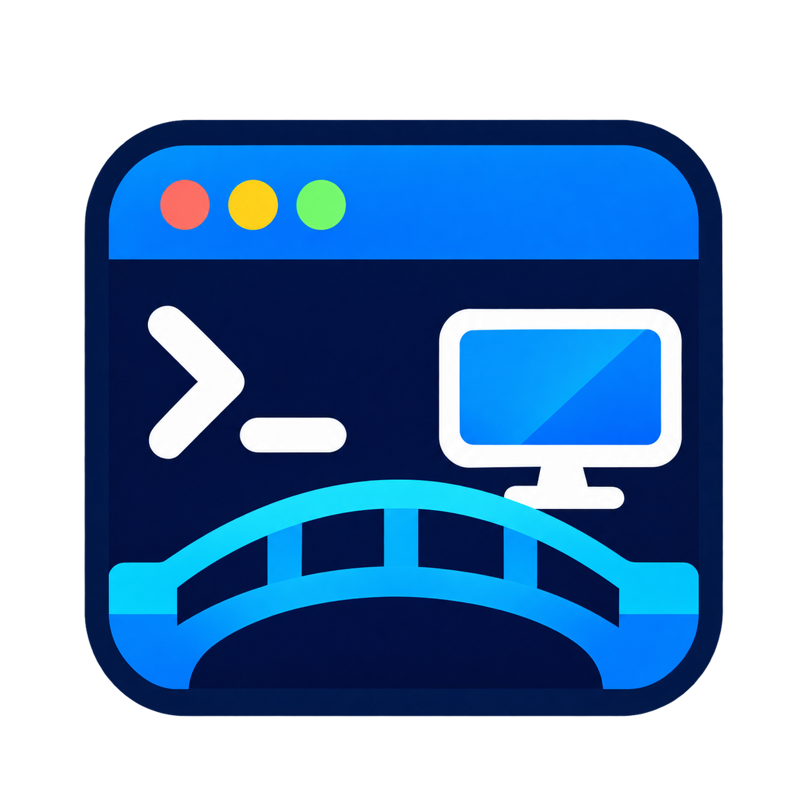
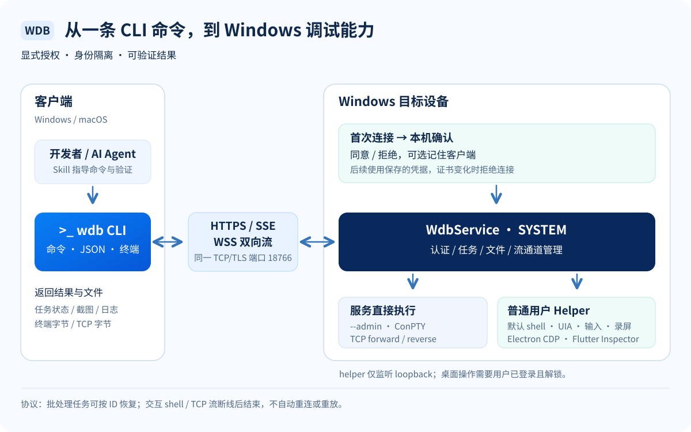

<p align="center">
  
</p>

<h1 align="center">WDB · Windows Debug Bridge</h1>

<p align="center"><strong>用一套 CLI 连接、操作和调试 Windows，让开发者与 AI Agent 共用同一条调试通路。</strong></p>

<p align="center">
  
  
  
  
  <a href="LICENSE"></a>
</p>

<p align="center">
  <a href="#quick-start">快速开始</a> ·
  <a href="#commands">核心命令</a> ·
  <a href="#how-it-works">工作原理</a> ·
  <a href="#agent-skill">Agent Skill</a> ·
  <a href="#development">参与开发</a>
</p>

## 项目介绍

WDB (Windows Debug Bridge) 由 Windows 后台服务、跨平台 CLI 和 Agent Skill 组成。可以在本机或局域网中执行脚本、传输文件、截屏/录屏、操作应用、采集日志，也可以进入交互终端或建立 TCP 端口转发。命令提供结构化结果，便于自动化系统查询状态、验证操作和处理失败。

WDB 面向 Windows 应用调试，设计参考 Android adb / Harmony hdc；截图与录屏用于观察和取证，目前不提供实时远程桌面视频串流。

当前版本为 **0.1.0**，采用 [MIT 许可证](LICENSE)。正式 npm 包与 GitHub Release 尚未发布；目前可从源码构建 CLI 和 Windows 安装器。

## 核心能力

| 能力 | 用途 |
| --- | --- |
| 设备连接与授权 | 仅用地址发起连接；服务端弹窗同意 / 拒绝，可记住客户端；查看状态、断开和撤销授权 |
| 任务与脚本 | PowerShell 批处理、任务查询 / 取消、SSE 输出与按任务 ID 恢复 |
| 交互式 shell | Windows ConPTY；PowerShell / cmd / 已安装的 pwsh；中文、窗口尺寸、Ctrl+C 和终端恢复 |
| TCP 转发 | `forward` / `reverse`；传输 TCP 字节，支持半关闭；监听和目标均限制为 loopback |
| 文件与应用部署 | 文件 / 目录推拉、SHA-256 校验、显式覆盖、安装 / 更新 / 卸载 |
| 桌面与输入 | 窗口管理、UI Automation、截图、键鼠 / Unicode 输入、Windows 触摸注入 |
| Electron 调试 | CDP + UIA + 视觉观察与操作；目标发现、DOM 查询、脚本和 console |
| Flutter 调试 | VM Service / Inspector + UIA + 视觉；Widget / 属性观察与操作验证 |
| 日志与录屏 | Windows 事件 / 文件日志、跟踪输出、MP4 录制及产物下载 |
| AI Agent | 同一套 CLI 与 Skill；先观察、再操作、后验证，无需在服务端配置模型密钥 |

## 系统要求

| 组件 | 当前范围 |
| --- | --- |
| Windows 服务端 | x64；安装预检要求桌面版 build 19045+、.NET Framework 4.8、Windows PowerShell 5.1 |
| Windows CLI | Node.js `>=22.0.0`；纯 JavaScript npm 客户端 |
| macOS CLI | macOS 14+ / Apple Silicon；Node.js `>=22.0.0`。交互 shell 需要 TTY；支持前台 TCP 正向与反向转发 |

桌面操作需要目标用户已登录且解锁。Flutter Inspector 依赖应用提供相应调试服务。

<a id="quick-start"></a>

## 快速开始

### 1. 安装 Windows 服务端

使用本地构建的以下一种安装器；[GitHub Releases](https://github.com/guoxiucai/wdb/releases) 作为后续正式下载入口，当前未发布正式产物。

| 安装器 | 适用场景 |
| --- | --- |
| `wdb-server-0.1.0-windows-x64-with-node-Development-setup.exe` | 自带固定版本 Node，目标机器无需安装 Node、npm、Git 或编译器 |
| `wdb-server-0.1.0-windows-x64-external-node-Development-setup.exe` | 使用系统已安装的合格 Node；要求受保护的安装路径、有效签名和匹配版本 |

双击安装器，通过 Windows UAC，并确认实际使用桌面的用户。安装完成后，`WdbService` 自动启动；程序位于 `C:\Program Files\wdb`，数据位于 `C:\ProgramData\wdb`。两个安装器共用一个服务与数据目录，可切换升级。

安装器会将 `C:\Program Files\wdb\bin` 加入系统 PATH。重新打开 PowerShell 后可直接运行 `wdb --help` 或 `wdb connect localhost:18766`；服务器本机无需再单独安装 npm CLI。该入口使用服务绑定的 Node，以当前用户权限执行。其他电脑上的客户端仍按下节安装 CLI。

首次安装默认监听所有 IPv4 地址 `0.0.0.0:18766`，自动创建只允许本地子网访问的防火墙规则。本机直接连接 `localhost`，局域网客户端直接连接服务器 IP，无需额外网络配置。升级保留已有监听与来源限制。

如需将访问限制到指定网卡，可在**服务器本机的管理员 PowerShell** 中运行以下可选命令，将示例 IP 换成服务器实际 IPv4：

```powershell
& 'C:\Program Files\wdb\scripts\set-network.ps1' -Mode Lan -LocalAddress 192.168.1.10
```

该操作更新监听与防火墙并重启服务，默认允许本地子网；不要在将被重启的 WDB shell 内执行。桌面 helper 始终只监听本机 loopback。

### 2. 安装 CLI

Windows 与 macOS 共用一个 npm tarball，需要 **Node.js `>=22.0.0`**。当前先安装本地开发包：

最低版本为 Node 22.0.0；Node 18 / 20 已停止上游维护，不再支持。推荐使用 Node 24 LTS 的受维护补丁版本。自带运行时的服务端安装包仍使用固定的 Node 24，不要求用户另外安装 Node。Electron/Flutter 调试的 WebSocket 使用已锁定的 `ws` 依赖。

```sh
npm install -g ./wdb-cli-local-test-0.1.0.tgz --omit=optional --ignore-scripts
wdb --version
wdb --help
```

Windows PowerShell 如限制 npm 生成的 `.ps1` 启动器，可使用 `wdb.cmd`。安装不包含服务端、不下载 Node、不执行安装 hook；Agent Skill 单独安装。

正式包名和 registry 安装命令将在发布后提供。源码构建方法见下方[本地开发与构建](#development)，安装与配置见 [npm CLI 指南](docs/NPM-CLIENT.md)。

### 3. 连接设备

```sh
# 同一台 Windows
wdb connect localhost
# 或从局域网客户端连接；请替换示例 IP
wdb connect 192.168.1.10
wdb devices
wdb info
```

首次连接时，在服务器桌面的“允许此客户端连接？”窗口选择同意或拒绝。

```text
connected to 192.168.1.10:18766
already connected to 192.168.1.10:18766
```

证书指纹在首次连接时保存，后续变化会拒绝连接。可选 `--fingerprint <SHA256>` 预先指定可信证书。

### 4. 常用操作

```powershell
wdb shell --script 'whoami; Get-Date' --json
wdb windows list --json
wdb screenshot --json
# 将截图结果中的远端路径替换到下面的命令
wdb pull '<远端截图路径>' './screen.png'

# 需要真实终端；Ctrl+C 发送给远端，Ctrl+] 退出会话
wdb shell

# 将客户端 9223 端口转发到 Windows 服务端本机 9222
wdb forward tcp:9223 tcp:9222
# 将 Windows 服务端本机 9000 转发到客户端本机 3000
wdb reverse tcp:9000 tcp:3000
```

转发命令各自在前台运行，用 Ctrl+C 停止。端口目标需要已有程序监听。交互 shell / 转发断线即结束，**不自动重连或重放**；批处理任务的查询与恢复另按任务 ID 处理。

当前 TCP 转发仍有已知的关闭阶段竞态：并发传输并半关闭连接时，可能截断尾部数据。修复完成前，不应将其用于要求可靠完整传输的场景。

<a id="commands"></a>

## 核心命令速查

| 命令 | 说明 |
| --- | --- |
| `connect` / `devices` / `info` / `disconnect` | 连接、实时设备列表、详情、主动断开 |
| `clients list` / `clients revoke <clientId>` | 查询与撤销客户端授权 |
| `shell --script '...'` / `shell --script-file ...` | 一次性 PowerShell 任务；默认普通用户 |
| `task list\|get\|wait\|cancel\|output\|delete` | 查询状态、等待输出、取消与清理任务 |
| `shell` / `shell --program cmd` | 交互终端；显式 `--admin` 使用 SYSTEM |
| `forward tcp:9223 tcp:9222` | 客户端监听 → 服务端 loopback 目标 |
| `reverse tcp:9000 tcp:3000` | 服务端监听 → 客户端 loopback 目标 |
| `push <本地> <远端>` / `pull <远端> <本地>` | 文件或目录传输；覆盖需 `--overwrite`，拉目录加 `--recursive` |
| `desktop status` / `screens` / `windows list` | 桌面会话、显示器与窗口信息 |
| `ui tree\|find\|action\|wait` | UIA 查询、操作与等待 |
| `screenshot` / `record start\|stop` | 截图与 MP4 录屏；产物通过 `pull` 取回 |
| `mouse` / `key` / `text` / `touch` | 键鼠、Unicode 文本与触摸轨迹 |
| `electron` / `flutter` | 应用专用调试通道 |
| `app launch\|list\|install\|update\|uninstall` | 启动与部署应用 |
| `logs events\|file` | 事件 / 文件日志，可跟踪输出 |

常规命令使用 `--json` 获取结构化结果，复杂参数使用 `--args-file file.json` 避免终端转义差异。多设备时显式加 `--device <地址或设备ID>`；设备 ID 为无分隔符的 16 位小写十六进制字符串。`devices --watch` 持续观察连接状态。交互 shell 要求 TTY，不支持 `--json`；转发的 `--json` 输出生命周期 NDJSON。

完整参数、错误语义、文件路径和操作示例请查 [CLI 手册](docs/CLI.md)，也可随时运行 `wdb --help`。

<a id="how-it-works"></a>

## 工作原理



CLI 通过 TCP 上的 TLS 加密连接到同一个端口（默认 `18766`）：HTTPS 处理命令、任务和文件，SSE 推送任务状态 / 输出，WSS 承载交互终端与 TCP 双向字节流。无需额外开放交互服务端口。

Windows 后台服务以 SYSTEM 运行；默认 shell 与桌面调试通过普通用户 helper 执行。只有显式 `--admin` 才请求 SYSTEM shell。流通道有窗口、配额、租约和关闭回收；ConPTY 进程树由 Windows Job 管理。

<a id="agent-skill"></a>

## 与 AI Agent 配合

将整个 [`skills/wdb`](skills/wdb) 目录放入所用 Agent 的 Skill 搜索目录，并确保 `wdb` 在该 Agent 的 PATH 中。具体使用规则见 [SKILL.md](skills/wdb/SKILL.md)。

Skill 指导 Agent 先查询窗口和控件，再执行操作，最后重新观察确认结果；UIA 不可用时按应用选择 CDP、Flutter Inspector 或视觉坐标。自动化脚本使用 `shell --script`，需要人类终端的交互 shell 单独使用。请求超时先查任务状态，避免重复点击、安装或输入。

## 权限与使用边界

- 首次连接必须由目标设备上的用户同意；后续校验证书及客户端凭据。首次保存指纹采用首次使用信任；需要预先核对身份时，使用 `--fingerprint` 指定可信指纹。
- WDB 提供执行脚本、文件和桌面操作能力；只授权可信客户端。记住的客户端可用 `clients revoke` 撤销；`disconnect` 仅断开，不撤销持久授权。
- 首次安装默认监听全部 IPv4，并由防火墙限制为本地子网；helper、CDP 和 VM Service 调试端点保持本机访问，不直接暴露公网。需要仅本机时运行 `set-network.ps1 -Mode Localhost`。
- UIA 和应用调试接口取决于应用自身实现。Electron 的 CDP 与可访问性是两条通路；Flutter 的具体构建要求见 [Flutter 指南](docs/FLUTTER.md)。
- 错误或超时不保证操作尚未发生。批处理任务应按任务 ID 查询状态；交互 shell 与转发断线后结束，不重放输入。安全问题报告方式见 [SECURITY.md](SECURITY.md)。


<a id="development"></a>

## 本地开发与构建

开发前阅读 [AGENTS.md](AGENTS.md)。Windows 开发环境需要 Node.js `>=22.0.0`；原生与安装器构建另需 .NET Framework 编译器、Windows PowerShell 和 Inno Setup 6.7.1。

```powershell
git clone https://github.com/guoxiucai/wdb.git
cd wdb
npm ci --omit=optional --ignore-scripts
powershell.exe -NoProfile -ExecutionPolicy Bypass -File scripts/init-data.ps1
powershell.exe -NoProfile -ExecutionPolicy Bypass -File scripts/build-pty.ps1
npm test
# 共享客户端测试
npm run test:client
```

测试使用独立数据目录；流协议测试还需要 OpenSSL。桌面实机、安装和故障注入有额外环境要求，不能用默认单元测试通过代替。初始化脚本默认写入忽略于 Git 的 `.runtime/server`。

仅构建 CLI 开发包：

```sh
node scripts/build-cli-npm.js --development true --license MIT --license-file LICENSE --output dist/npm/local-dev-01
```

构建包含 CLI 与两个 Windows EXE 的开发分发：

```powershell
.\scripts\build-release.ps1 -Phase Prepare -SigningMode Development -BuildId local-dev-01 -License MIT -LicenseFile (Join-Path $PWD 'LICENSE')
.\scripts\build-release.ps1 -Phase Package -BuildId local-dev-01
.\scripts\build-release.ps1 -Phase Finalize -BuildId local-dev-01
.\scripts\verify-release.ps1 -ReleaseDirectory dist/release-builds/local-dev-01/release/Development
```

每次修改源码后使用新的 BuildId。三阶段冻结公共 payload 并验证完整性，输出安装器、npm tarball、SHA-256 和构建报告；正式签名流程见 [安装器指南](docs/WINDOWS-INSTALLERS.md)。生成的 `dist/`、`artifacts/` 和本机凭据不提交 Git。

### 目录结构

```text
bin/           CLI 启动器
src/           CLI、服务、任务、传输协议与平台适配
native/        Windows 服务宿主、桌面桥、ConPTY C# 源码
scripts/       构建、安装、校验与实机验证工具
packaging/     npm 白名单、安装器模板、依赖锁定清单
tests/         自动化回归与测试夹具
skills/wdb/    AI Agent Skill
docs/          用户指南、协议、验证报告与图形资产
AGENTS.md      项目开发、验证、提交与交付规范
```

## 后续计划

- 完善 Mac 终端兼容性与使用体验。
- 扩展 Windows 版本兼容性，改善跨主机连接稳定性。
- 发布正式 npm 包和签名 Windows 安装器。

## 贡献与反馈

欢迎通过 [Issues](https://github.com/guoxiucai/wdb/issues) 报告可复现问题或讨论功能，通过 [Pull Requests](https://github.com/guoxiucai/wdb/pulls) 提交改进。请提供版本、平台、最小复现步骤和脱敏日志；开发规范、测试选择与提交要求见 [CONTRIBUTING.md](CONTRIBUTING.md)。漏洞和凭据不要放入公开 Issue。

## 许可与致谢

WDB 采用 [MIT 许可证](LICENSE)，允许使用、修改和再分发，具体条件见许可证全文。第三方依赖及随包组件仍遵循各自许可证，不因 WDB 使用 MIT 而改变。

感谢 Node.js、ws、FFmpeg、Inno Setup 及 Windows ConPTY / UI Automation 生态提供基础能力。第三方依赖遵循各自许可，发行包保留相应声明。
