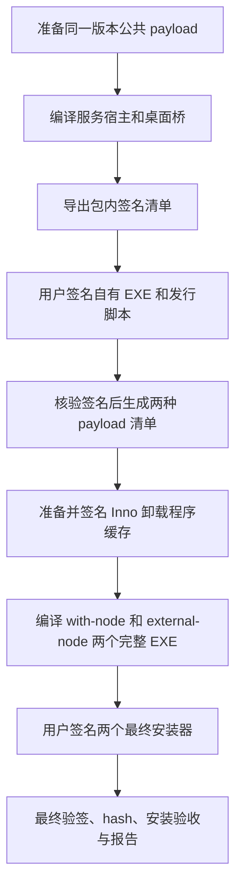

# WDB 分发与 Windows 服务端打包实现交接

编写日期：2026-11-06。状态：**实现方案，尚未完成 npm 发布和 EXE 安装包实现**。本文交接给 Windows 开发环境执行开发、构建、人工签名和实机验收；文中的新增文件、参数及命令均为待实现接口，不能当作现有功能运行。

## 1. 已确认的交付目标

| 产品 | 正式交付物 | Node 策略 | 目标使用方式 |
| --- | --- | --- | --- |
| Windows / macOS CLI | 同一个纯 JavaScript npm 包 | 不携带、不自动下载 Node；使用用户环境 Node | 安装 Node/npm 后执行 `npm install -g <包名>`，通过 `wdb` 使用 |
| Windows 服务端：内置 Node | 单文件 EXE 安装器 | 包内含经过验证的 Windows x64 Node | 无 Node 的机器也能离线安装运行 |
| Windows 服务端：外部 Node | 单文件 EXE 安装器 | 不含 Node，安装前检测系统级 Node，缺失时提示用户安装 | 复用管理员维护的 Node |

一次完整发布构建必须生成两种服务端 EXE，版本、源码提交、业务功能一致，只允许 Node 依赖策略及对应元数据不同。这里的 EXE 是**包含程序文件的安装器**，不是把全部 JavaScript 编译成一个原生服务进程。

本轮两种服务端整包均包含 FFmpeg、ffprobe、桌面桥、服务宿主、必要脚本和许可文件，保留完整录屏能力。先前讨论的“录屏组件可选下载”不纳入本轮，避免同时形成四种安装组合。CLI 不包含这些 Windows 组件。

用户负责手动签名。构建流程必须支持签名前准备、签名清单导出、签名后继续打包和最终验证；没有证书时仍可生成明确标注的开发测试包，不能把它标记为正式签名发行版。本文不授权自动发布 npm、上传发行文件或使用签名私钥。

## 2. 接手时先核对源码基线

编写时 Git HEAD 为 `039dc30`，已推送；连接复用、任务 SSE、相关测试与说明仍存在于 Mac 工作区的未提交改动中。Windows 接手前，需要将这些文件连同本交接文档纳入可追溯提交，或完整交接包含未跟踪文件的补丁。**仅拉取 `039dc30` 不会取得上述工作区改动。** 实际开发以接手时确认的提交为准。

| 现有位置 | 当前行为 | 本轮需要处理 |
| --- | --- | --- |
| 根 `package.json` | `private:true`；CLI、server 共用开发仓库 | 保留根包私有，另生成只含 CLI 的可发布包 |
| `src/cli.js`、`src/client-transport.js`、`src/device-id.js` | 跨平台客户端，使用 Node 内置模块 | 继续共享；补 npm 入口和运行时版本检查 |
| `scripts/build-client.ps1`、`scripts/build-client-macos.sh` | 复制 Node，生成平台专用客户端目录 | 新增统一 npm 构建作为正式渠道；旧脚本可保留为历史/开发入口，文档不能混称当前默认分发 |
| `scripts/build.ps1` | 编译两个原生程序、复制本机 Node，生成目录包 | 拆成准备 payload 和编译双版本安装器；锁定构建依赖 |
| `scripts/install-service.ps1`、`scripts/repair-service.ps1` | 假定随包 Node；缺文件时可能在目标机触发构建 | 明确区分运行时模式；正式包缺文件直接失败，不在客户机器编译 |
| `native/ServiceHost.cs` | 支持绝对 `--node` 路径，监督 Node 子进程 | 复用此接口；外部运行时失效要有明确诊断，不能悄悄换 PATH 中的 Node |
| `native/desktop.ps1` | 桌面桥缺失或源码较新时自动编译 | 正式安装模式禁止运行时编译，避免覆盖已签名 EXE；开发模式另行显式开启 |
| `scripts/set-network.ps1` | 防火墙程序路径固定为包内 `runtime/node.exe` | 根据实际运行时绑定生成规则，模式切换时更新 |
| `scripts/verify-package.ps1` | 所有包都要求随包 Node | 拆分 npm、内置 Node payload、外部 Node payload 和最终安装器验证 |
| `scripts/uninstall-service.ps1` | 删除服务/任务，默认保留程序文件 | 由 EXE 卸载器删除安装器拥有的文件，继续默认保留用户数据 |

现有安装路径、配对、TLS 指纹、deviceId、任务记录和桌面助手权限模型应继续兼容。包装改造不改变 WDB 通信协议，也不增加交互式 shell、WSS 或端口转发。

## 3. 客户端 npm 包

### 3.1 包结构与入口

建议在仓库维护 `packaging/npm/package.template.json` 和 CLI README 模板，由跨平台的 `scripts/build-cli-npm.js` 把必要文件复制到全新的 staging 目录。`src` 仍为唯一源码，不维护 Windows/Mac 两套发布代码。

```text
dist/npm/stage/
  package.json
  bin/wdb.js                 # 纯 JS 启动器，shebang 为 #!/usr/bin/env node
  src/cli.js
  src/client-transport.js
  src/device-id.js
  docs/                      # 客户端所需文档及其相对引用的闭包
  skills/wdb/                # Skill 原文件；安装时不自动复制到其他应用
  README.md
  LICENSE                    # 使用维护者确认的项目许可，不自动假定 MIT
  BUILD-INFO.json
```

模板的主要字段如下。`@your-scope/wdb` 是示例，发布前替换成维护者拥有的真实包名；版本由仓库根 `package.json` 注入。

```json
{
  "name": "@your-scope/wdb",
  "version": "0.1.0",
  "description": "WDB command-line client for Windows servers",
  "type": "commonjs",
  "bin": { "wdb": "bin/wdb.js" },
  "engines": { "node": "^24.15.0" },
  "files": ["bin/wdb.js", "src", "docs", "skills", "BUILD-INFO.json", "README.md", "LICENSE"]
}
```

不要把根开发包的 `private:true` 复制进发布包；也不要直接取消根包私有标记后从仓库根发布。发布 staging 中没有测试证书、`.runtime`、`artifacts`、开发脚本、服务端代码、截图、配对配置、访问令牌或 `.npmrc`。当前源码不足以决定项目许可，必须由维护者补齐实际 LICENSE 和相应 manifest 字段。

npm 根据 `bin` 建立平台命令入口，Windows 可用 `wdb.cmd`，Mac 使用 Node shebang 入口；不再调用现有“强制包内 Node”的 Mac shell 启动器。[npm bin/files 文档](https://docs.npmjs.com/cli/v11/configuring-npm/package-json/)

### 3.2 Node 兼容契约

第一阶段明确支持 Node `>=24.15.0 <25`，推荐用户安装 24 LTS 分支最新安全补丁。24.15.0 是已有验证基线，不代表应永久固定在该补丁版本。Node 26 等其他大版本完成双平台测试后，才能扩大兼容范围；不能只写无上限的 `>=24` 来暗示所有未来大版本已获支持。[Node 发布状态](https://nodejs.org/en/about/previous-releases)

纯 JS 入口在加载主要模块前检查运行时；版本不兼容时给出当前版本、支持范围和安装指引，并以非零退出。实现 `--json` 情况下的结构化错误，不能破坏现有 stdout 契约。`engines` 用于声明要求，还需要启动时检查；npm 默认不保证严格拒绝不兼容引擎。[npm engines 文档](https://docs.npmjs.com/cli/v11/configuring-npm/package-json/#engines)

用户没有 Node/npm 时先按 README 安装前置环境；npm 包本身不能在 npm 尚不存在时负责安装 Node。CLI 可以使用用户级版本管理器，这是客户端进程；第 5 节服务端的系统级路径要求不套用到 CLI。

产品版本以根 `package.json` 为构建源，CLI/server 的 `--version` 或 health 不再独立写死。发布包与安装目录都放置对应版本的 package.json，并验证输出一致。protocolVersion 独立维护，不能因改包装而随意增加协议版本。

### 3.3 构建与发布流程

1. 生成空 staging，按白名单复制源码、文档和 Skill，写入产品版本、Git SHA、构建时间、Node 支持范围。
2. 在 staging 执行 `npm pack --dry-run --json`，核对文件白名单及意外包含的文件。
3. 执行 `npm pack --json --ignore-scripts` 得到 `.tgz`，记录 `size`、`unpackedSize`、完整文件列表、integrity 和独立 SHA-256。两平台安装同一个 tarball。[npm pack 文档](https://docs.npmjs.com/cli/v11/commands/npm-pack/)
4. 在 Windows 和 Mac 分别用隔离 prefix 安装该 tarball，运行 CLI 回归与真实服务器闭环。测试从安装产物启动，不能仅执行仓库 `src/cli.js`。
5. 对已验证的同一个 tarball 发布；不要发布前重新从可能变化的工作目录打包。npm 发布凭据由发布者登录/凭据服务提供，不进入代码、日志或包。
6. 先发布预发布版本/tag，例如 `next`，完成 registry 安装复验后再推广稳定 tag；公共包使用维护者确认的 public 访问配置，内部包使用指定私有 registry。构建脚本不自动执行发布。

不设置会下载 Node、编译原生组件、申请管理员权限或注册服务的 install/postinstall hook。当前 CLI 无第三方运行依赖，保持此特性。体积目标为 tarball 和解压内容均小于 1 MB，作为预算检查；新增必要内容使其超出时应输出明细并评审，不能通过删许可来达标。

原客户端凭据位置保持不变，npm 更新/卸载只影响程序文件。迁移后指引用户移除自己配置的旧 portable PATH/符号链接，并用 Windows `where.exe wdb`、Mac `command -v wdb` 核实入口；安装器或 npm hook 不擅自删除旧目录和配对配置。

### 3.4 客户端签名边界

纯 JS npm 包通过已安装的 Node 执行，通常不需要为 CLI 单独办理 Windows Authenticode 签名或 Apple Developer ID 公证。此结论仅适用于本方案中不携带原生程序/扩展的形态；后续加入原生二进制、Mac app 或 pkg 要重新评估。npm 发布来源验证与操作系统代码签名是两回事。[苹果公证说明](https://developer.apple.com/documentation/security/notarizing-macos-software-before-distribution)

Windows 的 PowerShell 脚本入口可能受执行策略约束，可使用 npm 提供的 `.cmd` 入口；不得通过安装脚本全局关闭执行策略、SmartScreen 或其他系统保护。[PowerShell 执行策略](https://learn.microsoft.com/en-us/powershell/module/microsoft.powershell.core/about/about_execution_policies)

## 4. Windows 服务端：每次构建两种完整 EXE

### 4.1 安装器与命名

建议使用 **Inno Setup**，在 Windows 构建机锁定编译器版本和来源。构建机还需要受支持 Node/npm、现有 .NET Framework C# 编译器、Windows SDK SignTool；客户机器不需要安装 npm、Inno Setup、Windows SDK 或 .NET SDK。

“整包”仍依赖目标 Windows 的系统组件：现有服务宿主和桌面桥是 .NET Framework 程序，管理/桌面脚本使用 Windows PowerShell，并依赖交互式桌面及 UI Automation。安装前须检查适配的 .NET Framework 4.x 运行时、Windows PowerShell 5.1 和所需桌面组件；不能把“不需要 .NET SDK”写成“不依赖 .NET 运行时”。Windows 实现阶段应锁定并实测最低系统/运行时版本，缺失组件时在修改现有安装前给出明确提示；不要求客户机器保留 C# 编译器，也不默认支持 Server Core 等无完整桌面的环境。

```text
dist/releases/<version>/
  wdb-server-<version>-windows-x64-with-node-setup.exe
  wdb-server-<version>-windows-x64-external-node-setup.exe
  SHA256SUMS.txt
  release-manifest.json
  signing-report.json
  verification-report.json
```

发布目录中的每个 EXE 都必须能独立安装对应版本，不能依赖旁边的 `.bin`、另一版本 EXE 或开发仓库。内置 Node 版安装过程不下载任何依赖；外部 Node 版在用户已安装合格运行时后也可以离线安装。缺 Node 时提示和提供官方安装指引，不静默下载、不偷偷落地一份 Node。

两版本共用固定 AppId、安装目录、服务名和升级通道，属于同一产品的两种运行时模式，不能并存成两套争抢端口的服务。[Inno AppId 文档](https://jrsoftware.org/ishelp/topic_setup_appid.htm)

安装器正常请求 UAC，目标为 x64 Windows；沿用既有系统支持矩阵，未实测的平台标记待验。默认安装 `C:\Program Files\wdb`，数据继续在 `C:\ProgramData\wdb`。不要把打包器的管理员账号误选成桌面助手用户：应枚举真实交互会话、让操作者确认目标用户；静默安装必须显式给出，不能依赖提升后的 `$env:USERNAME`。[Inno 权限文档](https://jrsoftware.org/ishelp/topic_setup_privilegesrequired.htm)

### 4.2 Payload 清单

| 内容 | with-node | external-node |
| --- | --- | --- |
| 服务端/助手 JS、共享模块、必要诊断工具 | 包含 | 同版本、同内容 |
| `native/WdbServiceHost.exe` | 预编译、先签名 | 同一个已签名文件 |
| `native/bin/DesktopBridge.exe` | 预编译、先签名 | 同一个已签名文件 |
| 运行所需 `native/*.ps1`、安装/修复/网络/管理脚本 | 包含，按第 7 节处理签名 | 同一套逻辑，接受运行时模式 |
| `runtime/node.exe`、Node 许可证 | 包含指定版本 | 不包含，也不复制外部 Node 到安装目录 |
| `runtime/ffmpeg.exe`、`ffprobe.exe`、许可和来源说明 | 包含 | 包含 |
| BUILD-INFO、payload 清单、项目及第三方许可 | 包含 | 包含，运行时模式不同 |
| 编译器、C# 源码、测试、开发脚本、用户数据 | 不作为生产运行依赖 | 不作为生产运行依赖 |

正式 payload 使用白名单，不把现有 build.ps1 的整目录复制方式直接套进安装器。不要在目标机依赖 Git、源仓库、Node 版本管理器或临时解压目录。服务自检使用绑定的 Node 和私有 CLI 模块；安装器不抢占 npm 提供的全局 `wdb` 命令。

`native/desktop.ps1` 需先区分发行模式与显式开发模式：发行模式仅执行已签名桌面桥，缺失时报修复安装；不能因源码时间戳变化重新编译。安装器/repair 脚本的“组件缺失就运行 build.ps1”分支也只允许用于显式开发模式。

### 4.3 构建一致性与依赖

编译一次公共 payload，完成内部签名后再派生两个模式；不要分别从两个可能变化的源码目录构建。正式发布要求干净提交，并记录 Git SHA；开发脏工作区允许构建，但产物必须标记 `sourceDirty:true` 和非正式发布状态。

新增依赖锁定清单，至少记录 Node、FFmpeg 包和安装器工具的准确版本、下载来源、SHA-256。内置 Node 不再任意复制构建机 PATH 命中的可执行文件；下载或选用已校验的官方 Windows x64 运行时缓存。依赖准备与安装器编译分离，缓存齐全时可断网重建。24.15.0 为历史测试基线，实际发行前选择并验证受支持分支的安全补丁。

FFmpeg 保留所选发行构建的许可证、来源、构建信息和对应源代码提供方式；当前脚本记录的构建为 GPL-3.0-or-later，不应只把 EXE 拿出来而丢弃这些材料。实际发布材料需与选定版本及其许可要求核对，不因 Node 模式不同而省略。

## 5. 外部 Node 的检测与绑定

服务以 SYSTEM 身份运行，桌面助手以选定登录用户运行，二者都必须能访问同一个合格运行时。登录用户终端里的 `node --version` 成功，不等于 SYSTEM 开机后可用。[Microsoft LocalSystem 说明](https://learn.microsoft.com/en-us/windows/win32/services/localsystem-account)

安装前检查要在停止现有服务之前完成：

1. 提供显式 Node 路径选项；自动发现优先检查系统级安装位置/登记信息，PATH 只作候选来源。
2. 规范化最终本地绝对路径，核对文件及父目录权限；拒绝普通用户可写位置、用户级 nvm/fnm/Volta 入口、临时目录、UNC 网络位置及未经验证的重解析跳转。不能先以管理员身份执行任意候选文件，再检查其可信性。
3. 核验可信来源/签名及可执行文件，再执行受控探测，读取 `process.execPath`、`process.version`、`process.arch`、`process.platform`。要求真实 `win32/x64` Node，版本落在当前受支持范围；拒绝版本管理器代理或依赖用户 shell 初始化的入口。
4. 固定服务宿主和助手的 `--node` 绝对路径；不在每次启动时重新搜索 PATH，也不静默退回另一份 Node。
5. 安装记录包含 runtimeMode、实际路径、版本、架构、校验摘要及验证时间；可信路径绑定应由 SCM/受保护安装记录管理，不能仅信任可被桌面用户修改的 JSON。原有任务产物目录仍需允许助手按既有模型工作，不通过放宽 Program Files 权限来解决。
6. 实际以 SYSTEM 启动服务，以目标交互用户启动助手，并分别检查 health/desktop 可用性。这一步才证明绑定有效。

未找到、版本不符或路径不安全时，安装器给出具体原因和官方 Node 安装指引，允许选择另一合格路径；不得先破坏现有安装。不要向用户宣称“必须装 npm”——服务运行只需要 Node，npm 仅用于客户端分发和开发构建。

诊断命令应报告运行时模式、绑定路径、要求版本和实际版本。外部 Node 被删除、移动或升级到不支持的大版本后，明确报告修复方式并限制重复日志；不能以 SCM 显示 Running 代替健康状态。受支持范围内的正常补丁升级允许复验使用，安装时记录的 hash 是追溯信息，不应导致所有正常 Node 更新永久失效。

内置版始终绑定安装目录内 Node，外部版始终绑定验证过的外部 Node。卸载 WDB 不删除、降级或更改外部 Node，也不修改全局 Node 版本选择。

## 6. 安装、升级、模式切换与卸载

安装逻辑继续复用现有服务/助手实现，但改造成可由安装器可靠调用、参数明确、退出码可判断的过程。不得重复叠加两个互不知情的 UAC 流程。

| 阶段 | 必须实现的行为 |
| --- | --- |
| 安装前 | 检查 OS/架构、依赖、磁盘空间、目标用户、端口、payload 完整性与运行时；选择 Localhost/LAN 策略 |
| 安装 | 管理员把程序写入受保护目录；首次生成证书和密钥；注册服务/交互助手；写入运行时绑定 |
| 启动验收 | 同时检查 SCM 状态、HTTPS 监听、实际 Node 路径、health、桌面助手；无人登录时明确“服务在线，桌面不可用” |
| 升级 | 完整 staging 验证后再停止服务；保存原版本程序/服务配置和运行时绑定；失败时恢复可工作的旧版本 |
| 模式切换 | 复用产品 AppId 和用户数据；新运行时验证通过后切换两进程及防火墙程序路径；成功后清理仅属于旧模式的文件 |
| 卸载 | 停止并移除服务、助手、WDB 防火墙规则、安装文件和卸载登记；默认保留配对、证书、配置、任务/产物 |

两方向都需验证：with-node → external-node 和 external-node → with-node。切换到外部模式时，新绑定未验证成功前不删除旧包内 Node；切换到内置模式后不卸载系统 Node。卸载只删除安装器实际拥有的文件，不递归清空用户指定的任意目录。

升级保留 deviceId、TLS 证书/指纹、客户端 token、记住授权、监听配置及任务记录；不得以重装为由自动重新初始化。临时授权依照现有服务重启规则失效，不能错误承诺“所有临时授权跨升级保留”。进行中的任务按既有重启恢复语义标为 unknown 等状态，不自动重跑。

不要以回滚为由直接覆盖期间产生的新用户数据。程序回滚与数据保留分别处理；若将来出现数据 schema 迁移，另定义可回滚策略后才能发行。

网络默认延续已有 Localhost 行为；需要 LAN 时由用户明确选择网卡/来源范围。外部 Node 版的防火墙规则必须绑定实际 Node 路径，不能继续写死包内路径；模式切换/修复后复验。桌面 helper 端口仍只在本机监听。

EXE 卸载器负责 Windows“已安装的应用”登记。当前卸载脚本保留 Program Files 文件的历史行为需要调整协调：程序文件由安装器清理，业务数据默认保留。显式清除数据单独提示影响，并限定为核实过的 WDB 数据目录。

## 7. 手动签名清单与顺序

**只签最终 Setup.exe，不会让包内 EXE 或 PowerShell 文件自动获得签名。** 需要交付一份机器可读的 `signing-plan.json` 和对应的人类清单，标明文件、归属、处理方式、签名者要求和当前状态。

### 7.1 哪些文件需要处理

| 文件类别 | 本方案的发行要求 | 处理时机 |
| --- | --- | --- |
| `native/WdbServiceHost.exe` | 用 WDB 发布者证书签名 | 编译后、封装前 |
| `native/bin/DesktopBridge.exe` | 用 WDB 发布者证书签名 | 编译后、封装前 |
| 将来新增的自有 EXE/DLL | 自动纳入清单，不能漏掉 | 封装前 |
| 实际交付的 `.ps1` / `.psm1` | 本项目发行规范要求签名，便于受管环境部署；这不是声称所有 Windows 机器都强制要求 | 内容和编码最终确定后、生成 hash 前 |
| Inno Setup 生成的卸载程序及安装临时副本 | 启用 `SignedUninstaller=yes`，按编译器支持的流程签名/复用签名缓存 | 编译安装器时，不能仅在安装完成后补签 |
| 两个最终 `*-setup.exe` | 用户逐个手动签名、附时间戳并验签 | 最终封装后 |
| 官方 Node.exe | 保留并验证上游签名/来源，不默认覆盖为 WDB 发布者 | 依赖准备及发布验证 |
| FFmpeg/ffprobe | 记录上游签名实际状态、来源和 hash，不假定上游一定签名 | 依赖准备及发布验证 |
| JS、JSON、文档、Skill、`.cmd` 等 | 纳入最终 payload 完整性清单；不把普通文件伪称为已做 PE Authenticode 签名 | 所有内容修改和内部签名完成后 |

第三方未签名程序即使位于已签安装器中，安装后仍是未签名程序。若目标企业策略要求每个可执行文件都有可信签名，应选用符合策略的发行构建，或由发布者明确处理第三方再签名并保留原始/最终 hash 与来源；不能默认冒称它们已由上游签名。此项要在真实目标策略下验收。

代码签名证书与 WDB 的通信 TLS 证书完全不同：前者由发布者管理，后者由每台服务端首次安装时生成。不要把某台设备的 `tls.pfx`、token、helper-secret 或发布者私钥打进安装器。

### 7.2 支持用户手动签名的构建阶段



Inno Setup 官方支持：启用 `SignedUninstaller` 而不设置自动 SignTool 时，首次编译生成待签名卸载程序文件，用户签名后再编译；编译器/相关设置变化时可能生成新的待签名文件。使用专门的 `SignedUninstallerDir` 缓存，两个变体可按编译器规则复用，不能只凭名字认为旧签名仍适用。[SignedUninstaller](https://jrsoftware.org/ishelp/topic_setup_signeduninstaller.htm)、[缓存目录](https://jrsoftware.org/ishelp/topic_setup_signeduninstallerdir.htm)

最终安装器编译后手动签名时，仍必须处理上述卸载程序及安装临时副本；Inno 文档明确指出，仅给最外层安装器补签不能自动保证临时副本有签名。通过真正安装/卸载确认，不把“Setup.exe 验签成功”当作全部签名完成。[Inno SignTool](https://jrsoftware.org/ishelp/topic_setup_signtool.htm)

建议新增 `scripts/build-release.ps1`，提供以下**待实现**阶段，使用同一个 BuildId 贯穿：

```powershell
# 1. 全新 staging，生成公共 payload、npm tarball 和包内签名清单
.\scripts\build-release.ps1 -Phase Prepare -SigningMode Manual

# 2. 用户完成包内签名后继续；始终生成两个变体
#    首次遇到卸载程序待签名项时，输出明确的续跑说明和文件路径
.\scripts\build-release.ps1 -Phase Package -BuildId '<BuildId>'

# 3. 用户签完卸载程序缓存后，按提示再次执行 Package
#    两个最终 Setup.exe 生成后，用户分别签名

# 4. 验证最终签名和包体，生成最终报告/校验清单；不执行上传
.\scripts\build-release.ps1 -Phase Finalize -BuildId '<BuildId>'
```

默认完整构建包含两个安装器，不允许漏掉其中一个却报告成功。`Manual` 模式的整个逻辑构建可以因人工签名分阶段续跑；“待签名”必须作为独立机器可读状态，不能报告 release-ready。另提供显式 `Development` 模式生成两种未签名测试 EXE，文件名或独立输出目录明确标识，仅供本地功能验证。

Package 续跑只消费 Prepare 的冻结产物和经授权的签名变化，不重新编译内部 EXE、不从变化的工作目录补拷文件。保持签名前清单/签名计划与签名后清单；校验签名者及 Authenticode 覆盖的内容，不能接受用另一份程序替换后随便刷新 hash。若 payload 内容需要修改，则产生新 BuildId、重新走相应签名阶段。

### 7.3 手工操作参考

在已配置 Windows SDK 和签名证书的环境中，以下为参考形式。路径、证书指纹、时间戳服务由发布者填写；`/sha1` 是选择证书的标识，不代表使用 SHA-1 对文件签名。

```powershell
# 自有 PE 文件和最终安装器使用 SignTool；逐文件检查退出码
signtool sign /sha1 '<证书指纹>' /fd SHA256 /tr '<RFC3161时间戳URL>' /td SHA256 '<待签名.exe>'
signtool verify /pa /all /v /tw '<已签名.exe>'

# PowerShell 文件用支持其格式的签名接口，不用字符串拼接签名块
$wdbSigningCert = Get-Item 'Cert:\CurrentUser\My\<证书指纹>'
Set-AuthenticodeSignature -LiteralPath '<待签名.ps1>' -Certificate $wdbSigningCert -HashAlgorithm SHA256 -TimestampServer '<兼容的时间戳服务URL>'
Get-AuthenticodeSignature -LiteralPath '<已签名.ps1>'
```

SignTool 来自 Windows SDK；SHA-256 和时间戳选项按微软文档使用。PowerShell 的时间戳服务兼容性要单独验证，不假设与 SignTool `/tr` 使用同一个端点。每个阶段检查有效签名、预期发布者、证书链及时间戳，签名工具警告不能静默当成发布成功。[SignTool](https://learn.microsoft.com/en-us/windows/win32/seccrypto/signtool)、[Set-AuthenticodeSignature](https://learn.microsoft.com/en-us/powershell/module/microsoft.powershell.security/set-authenticodesignature)

用户手动输入硬件令牌 PIN、使用系统证书库或自己的签名工具。构建工具不索取、保存或打印 PFX 密码/PIN，不将私钥提交仓库。签名后的脚本不可再转换换行/编码，签名后的 EXE 不再修改版本资源；否则必须重新签名。

### 7.4 Hash 与报告顺序

1. 保存原始上游依赖校验信息和 Prepare 阶段清单。
2. 完成包内文件签名后，生成每个变体的 `PAYLOAD-SHA256SUMS.txt`；该文件不包含自身。
3. 将该清单和 BUILD-INFO 一起封入安装器；正式安装前按可信清单验证解压 payload，再执行其中的管理脚本。
4. 最终安装器签名完成后，才生成发布目录的 `SHA256SUMS.txt` 和最终大小报告。
5. 报告与清单避免互相包含 hash 形成循环：payload 清单覆盖固定 payload；发布清单覆盖最终 EXE/npm tarball；报告引用产物 hash，不要求产物内包含最终报告的 hash。

签名会改变文件字节，不能沿用签名前的 hash。SHA-256 清单用于完整性核验，不独立证明发布者；正式安装器验签和可信分发来源仍需保留。签名也不保证所有新文件都立即拥有 SmartScreen 信誉，需记录实测提示。[微软 SmartScreen 说明](https://learn.microsoft.com/en-us/windows/security/operating-system-security/virus-and-threat-protection/microsoft-defender-smartscreen/)

## 8. 建议新增/调整的文件

| 文件/目录 | 责任 |
| --- | --- |
| `packaging/npm/package.template.json`、CLI README 模板 | npm 文件白名单、入口、支持 Node 范围 |
| `scripts/build-cli-npm.js`、`scripts/verify-cli-npm.js` | 跨平台打包、tarball 检查、隔离安装测试 |
| `bin/wdb.js` | npm 启动入口，版本检查，调用共享 CLI |
| `packaging/windows/wdb-server.iss` | 两运行时模式的统一安装器定义、固定 AppId、卸载与 UI |
| `packaging/windows/dependencies.json` | 构建依赖版本、来源和 hash；不含凭据 |
| `scripts/build-release.ps1` | BuildId、Prepare/Package/Finalize、双变体与人工签名续跑 |
| `scripts/prepare-server-payload.ps1` | 编译/复制白名单、两模式文件差异 |
| `scripts/resolve-node.ps1` | 外部/内置 Node 的统一解析和校验，供安装/修复/网络/诊断复用 |
| `scripts/verify-release.ps1` | payload、签名状态、两个最终 EXE、版本和大小报告 |
| 现有 install/repair/uninstall/set-network/service 脚本 | 参数化运行时、事务式升级、固定路径、诊断、干净卸载 |
| `native/desktop.ps1`、必要的 ServiceHost 调整 | 发行模式不动态编译；运行时故障可诊断 |
| README、Windows/Mac CLI 指南、服务文档 | 标明 npm 为正式 CLI 渠道和双 EXE 安装方式，保留历史验收边界 |
| 新的发行验证报告 | Windows 实机记录；不能直接把本文或历史 portable 记录当成新包验收 |

这些名字是建议接口，可根据现有脚本职责调整；必须保留单一 Node 解析实现和统一双变体构建入口，避免各安装/网络脚本继续各自猜路径。

## 9. 实施顺序与验收闭环

### 9.1 阶段划分

1. **确认源码与发布参数**：接收全部工作区变更，确定版本、npm 包名/registry、项目许可和发布者信息。
2. **CLI npm 化**：实现入口、版本检查、白名单和打包；在 Windows/Mac 从同一 tarball 安装验证。此阶段不依赖签名证书。
3. **运行时双模式**：先完成外部 Node 发现/绑定和现有脚本兼容，再验证两个 payload，避免仅在安装器里隐藏路径差异。
4. **安装器闭环**：生成两种开发测试 EXE，验证安装、升级、双向模式切换、卸载和失败恢复。
5. **手动签名闭环**：导出清单，用户完成内部文件、卸载程序和外层安装器签名；完成 Finalize。
6. **发行验收**：在干净机器安装最终已签名 EXE；从 registry 安装候选 CLI；完成跨机器操作后再发布稳定版本。

### 9.2 必须记录的验收矩阵

| 编号 | 场景 | 通过标准 |
| --- | --- | --- |
| C01 | Windows x64 / Mac arm64，受支持 Node，安装同一 npm tarball | `wdb --version`、help、JSON 正常；不需要仓库和随包 Node；记录 Node 与 OS 版本 |
| C02 | 最低受支持版本、选定最新补丁、不支持的大版本 | 支持版本通过；不支持版本明确拒绝；不误把只测试 Node 24 当作全大版本通过 |
| C03 | npm 包内容、体积和来源 | 无原生二进制/服务代码/凭据；记录 tgz 和解压 bytes；registry 下载产物与候选包一致 |
| C04 | 空格/中文路径、任意 cwd、Windows cmd/PowerShell 入口 | 正常执行；`.ps1` 受策略限制时 `.cmd` 入口行为明确；不修改全局安全策略 |
| C05 | npm 更新、卸载、旧 portable 切换 | 凭据和配置保留；PATH 命中预期入口；不删除用户的旧包和 Node |
| S01 | 无 Node/npm、具备受支持系统组件的干净 Windows，安装 with-node EXE | 断网安装成功，服务绑定随包 Node，助手可用，不要求目标机编译；记录 .NET Framework/PowerShell 版本 |
| S02 | 无 Node，安装 external-node EXE | 安装前明确提示，未落入半安装状态；原有服务不受影响 |
| S03 | 合格系统 Node，安装 external-node EXE | payload/安装目录均无私带 Node，服务与助手绑定外部绝对路径；断网运行 |
| S04 | 仅有用户 nvm/fnm、错误版本/架构、用户可写/无权限路径 | 给出具体拒绝原因，不将这些入口绑定给 SYSTEM |
| S05 | 重启、无人登录、锁屏、登录解锁 | 服务开机运行；桌面可用性正确区分；普通 shell/助手仍为目标用户，显式 admin 为 SYSTEM |
| S06 | 两模式各自升级、两方向模式切换、旧目录包迁移 | 同一个产品/服务；配对与证书保留；运行时和防火墙路径一致；无残留旧服务/进程 |
| S07 | 系统组件/运行时依赖缺失、端口占用、取消 UAC、文件复制失败/磁盘不足 | 不声称安装成功；预检失败不修改现有安装；升级失败可恢复旧版本；业务数据不被清空 |
| S08 | 外部 Node 补丁更新、删除、移位、升级到不支持版本 | 支持补丁可复验；失效明确诊断，repair 可重新绑定，不随机改用 PATH |
| S09 | 卸载与重新安装 | WDB 服务/助手/规则/程序文件清理；默认保留数据；外部 Node 不被删除；重新安装能沿用记住授权 |
| A01 | 内部程序、脚本、卸载器、两种最终安装器签名 | 所有自有待签文件有效且发布者正确；第三方状态逐项记录；实际安装和卸载验证 |
| A02 | payload/安装器篡改、缺失文件、签名后改内容 | 验证失败，阻止执行损坏的安装内容；重签后重新生成校验值 |
| R01 | Windows 和 Mac npm CLI → 两种安装器部署的服务 | 首连同意/拒绝/记住、重连、devices、shell、文件往返、截图拉取都闭环 |
| R02 | 完整录屏 | 两模式均录制并拉回短 MP4；ffprobe 检查、解码并实际查看；保留长时录屏历史边界 |
| R03 | 连接复用/SSE（如果已纳入该发行提交） | 无重复执行；事件输出不重复/乱码；断流恢复、撤销和超时正确；旧服务端可回退 |
| R04 | 安装源与数据隔离 | 删除安装下载目录/开发仓库后仍运行；程序目录普通用户不可写；产物无设备密钥 |

Windows 10/11 不同版本按现有支持矩阵逐台执行；目标版本与当前实测差异见[既有验收记录](ACCEPTANCE.md)，尚无机器的格子明确写“未验证”。Mac 范围沿用 [macOS 开发说明](MACOS-CLI-DEVELOPMENT.md) 中的 macOS 14+ / arm64，其他架构不因使用纯 JS 就自动宣称已验证。Mac npm 包也必须在真实 Mac 验证，仅 Windows `npm pack` 成功不能代替。默认用户不是管理员、使用另一管理员账号完成 UAC 的安装场景必须包含在 S05/S06 验证中。

测试应使用独立测试目录、客户端身份和可控桌面窗口。安装/卸载会改变本机服务状态，应在 Windows 开发者安排的测试机或 VM 执行，不在正在使用的生产设备上随意重启。复用已有 LAN/CLI 验证脚本时先更新入口，确保调用的是 npm 安装产物。

### 9.3 报告与完成定义

`release-manifest.json` 至少记录产品版本、协议版本、BuildId、Git SHA/dirty、构建时间、工具版本、运行时模式/支持范围、内置依赖版本、每个产物的 bytes 和 SHA-256。大小区分下载 EXE/tgz、payload 解压文件合计和安装后文件合计；外部 Node 不计入 WDB 安装目录，但单独列出前置环境。

`signing-report.json` 记录相对文件路径、归属、预期/实际签名状态、发布者、证书指纹、时间戳、最终 hash；第三方缺签名要真实呈现。`verification-report.json` 对每个矩阵编号记录 pass/fail/not-run、机器环境、产物 hash、证据路径及问题。报告不包含令牌、私钥、证书密码、PIN 或用户业务截图。

交接闭环完成需同时具备：同一 npm 包的双平台运行验证、同次构建的两个 EXE、手动签名清单及最终验签、双模式安装/升级/切换/卸载记录、跨机器真实 CLI 操作、可追溯版本和更新后的使用说明。仅产出 EXE 或 `npm publish` 成功不算完整验收。

正式发布前仍需维护者确定实际 npm scope/registry 和访问权限、WDB 项目许可、安装器发布者/AppId、签名证书及时间戳服务、选定 Node 补丁及依赖锁定值。这些参数不应阻塞本地构建和测试实现，但占位值不得进入正式发布。
