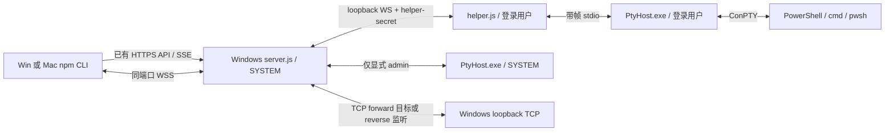

# WDB 交互式 Shell 与 TCP 端口转发实现交接

日期：2026-11-06。源码基线：`41f00e4`。状态：**设计与实现约定，尚未实现或完成实机验收**。本文中的新命令、接口、模块及配置均为待实现内容。

开发顺序：先在 Windows 完成 Win server、Win CLI 和协议回归，再将同一份客户端协议代码交接到 Mac，实现并验证本地终端适配。两端不要分别发明协议。已有分发策略继续适用：CLI 为不含 Node 的 npm 包，服务端生成含 Node / 不含 Node 两种完整 EXE 安装包。

## 1. 实现目标与技术选择

保留现有 HTTPS JSON API、文件传输、keep-alive 池和任务 SSE。新增同一 HTTPS 监听端口上的 **WSS 双向通道**，承载终端输入/输出与 TCP 字节流，继续使用已有配对、Bearer token、TLS 指纹和 deviceId。

| 能力 | 本方案 |
| --- | --- |
| 执行单次 PowerShell 命令 | 保留现有 `shell` 异步任务、SSE、结果查询和恢复语义 |
| 进入交互式 shell | 新建 Windows ConPTY 会话；支持持续状态、键盘输入、终端尺寸和正常退出 |
| 正向转发 `forward` | 客户端监听 → Windows 服务端本机 TCP 服务 |
| 反向转发 `reverse` | Windows 服务端监听 → 客户端本机 TCP 服务；在正向完成后实现 |
| 端口和证书 | 远程连接仍使用原 HTTPS 端口，默认 `18766`；没有另一个对外明文监听端口 |
| 首版运行方式 | shell 和转发均由前台 CLI 维持；退出或断线清理所属资源 |
| 首版边界 | TCP、loopback 端点；不包含 UDP、SOCKS、任意网络代理、后台常驻 CLI、shell detach/reattach |

WebSocket 是在 HTTP Upgrade 后运行的独立双向协议；WSS 的字节流继续受到 TLS 保护，不是把每次按键变成 HTTP 请求。[RFC 6455](https://www.rfc-editor.org/rfc/rfc6455.html)

首版采用“一条终端一条 WSS；一条转发规则一条控制 WSS；每条实际 TCP 连接一条数据 WSS”。这样每条连接可以独立处理背压和半关闭。**不在首版自研把所有 TCP 连接塞进一条 WSS 的多路复用协议。** 代价是新 TCP 连接需要新 TLS/Upgrade 握手，验收必须记录其开销；若以后需要多路复用，以新的子协议版本实现。

HTTPS keep-alive 仍服务普通 API；Upgrade 后的 socket 由对应流独占，不能返回普通请求池。已有 SSE 不迁移到 WSS，也不改变任务重试策略。

## 2. CLI 使用契约

以下为目标用法，当前版本不可直接使用新增命令。

```text
# 无脚本且处于真实终端时，进入交互式 Windows PowerShell
wdb --device <deviceId> shell
wdb --device <deviceId> shell --interactive
wdb --device <deviceId> shell --interactive --program cmd --cwd C:\work
wdb --device <deviceId> shell --interactive --program pwsh

# 显式管理员模式：沿用 WDB 的 SYSTEM 语义
wdb --device <deviceId> shell --interactive --admin

# 已有批处理用法保持原行为
wdb --device <deviceId> shell --script "Get-Process" --json

# 本机 9223 → Windows 本机 9222，命令在前台保持运行
wdb --device <deviceId> forward tcp:9223 tcp:9222

# Windows 本机 8081 → CLI 所在机器本机 8080
wdb --device <deviceId> reverse tcp:8081 tcp:8080

# 监听端口 0 表示分配空闲端口；输出实际地址
wdb --device <deviceId> forward tcp:0 tcp:9222 --json
```

### 2.1 Shell 参数及输出

1. `shell` 无脚本、无位置参数，且 stdin/stdout 都是 TTY 时，等价于 `shell --interactive`。非 TTY 返回 `TTY_REQUIRED`，不偷偷进入交互模式或等待 stdin。
2. 有 `--script`、`--script-file` 或 `--` 后命令时继续走现有任务接口。`--interactive` 与这些脚本参数、`--json`、`--detach`、`--follow` 同时出现时返回 `INVALID_ARGUMENT`，不执行任何命令。
3. `--program` 首版枚举为 `powershell`、`cmd`、`pwsh`；默认 `powershell`。PowerShell 7 不随包安装，找不到时返回 `SHELL_NOT_FOUND`。不接受任意可执行文件字符串或任意启动参数。
4. `--cwd` 和现有 JSON `--env` 表示远端环境；普通会话默认使用 helper 用户的用户目录。环境变量按结构化字段传递，不能拼接成 PowerShell 命令。
5. 终端数据直接写 stdout，状态提示写 stderr；ConPTY 输出是一个混合终端流，不承诺分别得到 stdout/stderr。交互结束不再打印现有 `printResult()` 的 JSON/任务结果。
6. `Ctrl+C` 发送终端字节 `0x03`，用于远端程序中断；不默认退出本地 CLI。输入 `exit` 正常退出远端 shell。默认 `Ctrl+]` 是本地结束会话键，不发给远端；`--escape none` 可禁用该快捷键。
7. 正常结束时，远端退出码为 0..255 则用作 CLI 退出码；其他 Windows 32 位退出码完整记入诊断，CLI 返回 1。协议/网络故障返回 1，本地主动快捷键退出返回 130；所有能够执行清理的退出路径都恢复终端状态，不可捕获的强杀限制见第 8.4 节。

现有参数解析器只识别 `--long-option`。新增 `interactive` 到布尔选项表，不要在文档中先引入实际解析不了的 `-i`、`-t`、`-L` 或 `-R`。

新命令的 `--request-timeout` 控制 TLS/Upgrade 和控制握手截止时间，默认 10000 ms；不作为整段交互时长。活动会话按 lease 维持，不继承批处理任务的执行时长或 waitTask 的等待上限。显式传入仅属于任务的 `--poll-ms/--wait-timeout` 或试图启用恢复的 `--reconnect-timeout` 时拒绝并说明不适用于流会话，避免让用户误以为断线后会恢复终端。

### 2.2 转发参数及运行方式

端点语法固定为 `tcp:<port>`、`tcp:127.0.0.1:<port>` 或 `tcp:[::1]:<port>`。简写固定为 IPv4 `127.0.0.1`，不使用操作系统对 localhost 的不同解析结果。端口为十进制整数；监听允许 0..65535，目标只允许 1..65535。

首版只接受字面量 `127.0.0.1` 和 `::1`，拒绝通配地址、域名、IPv4-mapped IPv6 和其他地址。这样不新增 DNS 解析/重绑定和开放到 LAN 的行为。远程 WDB 地址仍可使用既有设备配置中的主机名。

两个命令都占用当前终端；用户在另一个终端访问映射端口。Ctrl+C 关闭规则和所属 TCP 连接，正常返回 0。规则创建失败返回非零。单条 TCP 连接失败只关闭该连接、报告具体原因，不默认结束整条规则。

人类模式在成功 ready 后打印一次实际监听地址、目标、方向和 forwardId。`--json` 在这两个持续运行命令中明确使用 NDJSON：`ready`、`connection_error`、`closed` 各为独立事件；绝不把转发字节写到 stdout。其他普通命令的单个 JSON 契约保持不变。

本版不承诺命令返回后端口仍在，也不新增需要本地 daemon 的跨进程 `forward --list/--remove`。停止前台命令即停止其规则；`wdb disconnect` 则停止该客户端身份在对应设备上的全部新流。

## 3. 进程与权限结构



普通交互 shell 必须由现有登录用户 helper 启动。helper 离线、未登录或身份不匹配时返回 `HELPER_UNAVAILABLE`，**不能自动改在 SYSTEM 下启动**。`--admin` 才允许服务端直接启动 SYSTEM ConPTY，会话 ready 信息明确返回实际身份与是否提升权限。

管理员模式是 WDB 现有 SYSTEM 能力，不是“当前桌面用户通过 UAC 提升”。不要在 SYSTEM 的 Session 0 内尝试显示交互式 UAC。Session 0 的 ConPTY 能力必须在目标 Windows 验证；不支持时报告 `PTY_UNAVAILABLE`。

TCP 端口转发由 server.js 建立服务器侧 socket，客户端由 CLI 建立另一侧 socket；它不使用 helper，也不冒充登录用户或自动提供目标协议的 Windows 登录凭据。无人登录时，已获授权的转发可以工作；普通交互 shell 不保证可用。

## 4. 对现有实现的具体接入点

| 当前模块 | 改造要求 |
| --- | --- |
| `src/server.js` 的 `listen()` | 在同一个 `https.Server` 注册 `upgrade`，保留现有 `route()`；Upgrade 不会自动走普通 route 授权 |
| `identify()`、`isApproved()`、`auth()` | 提取可共享的身份/授权验证和 socket 登记；流认证不应顺带续期桌面输入 lease |
| `DELETE /v1/connection`、撤销客户端 | 同步关闭所属 WSS、PTY、转发监听和 TCP；不只操作任务/SSE |
| `Bridge.close()` | 显式关闭 Upgrade socket 和所有流资源，不能只依赖 `closeAllConnections()` |
| `src/client-transport.js` | 共享指纹规范化、设备身份和本地 disconnected 检查；新增独立 WSS 打开路径，不套用任务提交恢复 |
| `src/cli.js` | 分离交互/前台转发生命周期与 `runTask()/waitTask()/printResult()`；统一 finally 清理 |
| `src/helper.js` | 增加本机 shell WS 入口；现有 `/execute` 一次性 HTTP 请求不适合持有无限终端输入输出 |
| `native/ServiceHost.cs` | 保留服务/助手的进程树管理；验证新增会话级 Job 与现有 Job 的嵌套和退出行为 |

Node 的 `server.closeAllConnections()` 不会销毁已经 Upgrade 成 WebSocket 的连接；显式注册和清理是必要改造。[Node HTTP 文档](https://nodejs.org/docs/latest-v24.x/api/http.html#servercloseallconnections)

## 5. WSS 基础传输和身份校验

### 5.1 实现库与客户端体积

建议服务端与客户端统一使用 `ws` 的纯 JavaScript 实现，锁定实现时核验过的精确版本和依赖锁文件；不手写 RFC 6455 帧解析。服务端使用 `WebSocketServer({ noServer:true, perMessageDeflate:false, maxPayload:65536 })`，在授权完成后调用 `handleUpgrade()`。

客户端同样关闭压缩、重定向，限制消息大小。首版不打包 `bufferutil`、`utf-8-validate` 等可选原生加速模块，不依赖 node-gyp；选择的 `ws` 版本必须能在 Node 24 纯 JS 模式运行。具体 API 以锁定版本为准，不直接照搬未来 master 新增选项。[ws 官方说明](https://github.com/websockets/ws#readme)、[API](https://github.com/websockets/ws/blob/master/doc/ws.md)

这是对分发方案中“当前 CLI 无第三方运行依赖”的有界扩展：允许增加一个小型纯 JS WebSocket 依赖，**仍不携带 Node、ConPTY 或原生扩展**。npm 包明确声明精确版本的生产依赖；CLI 包体报告同时统计 npm 依赖安装后的总大小，不能只报自身 tgz。

两种服务端 EXE 都离线携带相同 `ws` 运行文件和许可证，不在客户机运行 npm 下载。构建机按锁文件准备生产依赖，并排除开发依赖/可选原生模块；若改用构建时 bundling，须保留许可并单独验证纯 JS 产物。

### 5.2 TLS Pin 必须早于 Upgrade 请求

沿用当前信任模型：连接已配对设备，匹配完整 SHA-256 证书指纹，再发送 Bearer。不得使用“先建立 WebSocket，再检查证书”的实现。

推荐复用现有 `openRequest()` 的时序思想，在锁定 `ws` 版本的 `finishRequest(req)` 钩子里等 TLS `secureConnect`、校验证书，再调用 `req.end()`：

1. 使用专用 HTTPS Agent，关闭 TLS session 缓存；不借用普通 API 的 5 秒 socket 超时和 8 连接池。
2. 配置已有 token 为 Authorization header，但在证书通过前不 `end()`、`write()` 或 `flushHeaders()`，也不将 socket 提前交给另一条已开始写入的请求。
3. 自签名证书可以使用 `rejectUnauthorized:false` 配合现有精确 pin 验证，但不能省略 pin。失败时销毁连接，保证对端未收到 HTTP 头、token 或操作参数。
4. 设置 TLS/Upgrade 总截止时间、AbortSignal 和一次性完成保护；处理握手中取消、关闭、错误，清理计时器。
5. `followRedirects:false`，拒绝重定向和跨 origin 迁移；不把 token 放 URL、查询参数或 WebSocket 子协议字段。

`finishRequest` 接管请求时需要由调用方显式完成 `request.end()`；实现时核验所选版本支持该钩子。验收必须从测试服务器接收字节的角度证明 pin 失败时没有 Upgrade 请求，而不只是客户端抛了异常。[ws 请求钩子文档](https://github.com/websockets/ws/blob/master/doc/ws.md#new-websocketaddress-protocols-options)

### 5.3 服务端 Upgrade 顺序

远程入口固定为 `GET /v1/stream`，无 query，要求子协议 `wdb.stream.v1`。该路径只接受 WSS；内部 helper 的 loopback WS 是第 8 节限定的独立通道。

依次检查路径/方法/版本、资源配额、Bearer、当前授权、Origin 策略，随后才 `handleUpgrade(req,socket,head,...)`。首版是 native CLI 专用入口，拒绝携带 Origin 的浏览器请求；不接受 Cookie 登录替代 Bearer。不要丢弃 `head`，也不要在进入正常消息循环前漏掉已收到的帧。

升级前错误返回带长度限制的 HTTP JSON 错误并关闭 socket；升级后只能发协议错误消息/WS Close，不能再用 `send(res,...)`。所有升级连接都登记到 clientId 和独立的流资源注册表。

## 6. `wdb.stream.v1` 协议契约

### 6.1 能力发现与握手

新增 health 字段示意如下；保留现有 `protocolVersion:1`、`taskEvents` 和其他字段。

```json
{
  "streaming": {
    "version": 1,
    "endpoint": "/v1/stream",
    "interactiveShell": true,
    "tcpForward": true,
    "tcpReverse": true
  }
}
```

只为已实现能力声明 true；阶段性只有 forward 时，reverse 为 false。接口能力与 helper 是否在线分开：`/v1/info` 返回 shell 当前可用性、程序列表和拒绝原因。旧服务缺字段时，新命令返回 `FEATURE_UNAVAILABLE`，不把交互 shell 降级成一次性脚本。旧 CLI 继续工作。

每条 WSS 升级成功后，服务器首先发送：

```json
{
  "type": "hello",
  "version": 1,
  "deviceId": "0123456789abcdef",
  "serverInstanceId": "c14fd534-e792-4998-aa79-150eab051c1d",
  "channelId": "2deae4b7-f236-42e4-8979-b9a96ef29542",
  "limits": {
    "binaryMessageBytes": 65536,
    "controlMessageBytes": 16384,
    "windowBytes": 262144,
    "leaseIntervalMs": 5000,
    "leaseTimeoutMs": 30000
  }
}
```

`serverInstanceId` 每次 server.js 启动随机生成，和持久 deviceId 区分。客户端先校验子协议、版本、deviceId，再发任何 `open` 参数；服务器此时不能已执行命令或拨号。转发子通道必须与所属控制通道具有相同 serverInstanceId。

每条 WSS 只允许一次 `open`，kind 为 `shell/forward/reverse/tcp` 之一。共同握手如下：

```text
TLS pin → HTTP Upgrade + Bearer → server hello
→ client open → server opened（分配资源，尚不交换业务字节）
→ client ready → server ready.ack → ACTIVE
```

每阶段默认设 10 秒截止时间；客户端可通过 request-timeout 缩短/调整自身等待，但服务端仍设置独立上限，不能任由未就绪资源长期驻留。超时回收预分配资源。shell 的 `opened` 只表示准备好了 owner/backend；在收到 ready 后才启动子进程。CLI 在 ready 前进入 raw mode 并安装输出处理器，避免丢失第一屏。ready.ack 包含实际 PID/身份；启动失败发 error 并清理。

forward 的 CLI 监听绑定也在 ready 前完成。reverse 的服务器可在 opened 前绑定监听，但在 ready.ack 前只暂停保存新连接，不发送 incoming。TCP 数据通道在双方 ready 完成前不读取源 socket。

### 6.2 控制消息与字节消息

文本 WebSocket message 是 UTF-8 JSON 对象；二进制 message 是原始字节，不使用 Base64，不按行切分，不添加通用多路复用头。以 WebSocket **完整消息**为单位限制大小，不能只限制单个 fragment。

带响应的客户端控制请求使用递增正整数 `requestId`，服务器以 `replyTo` 关联。重复/倒退 requestId 或第二次 open 是协议错误；该编号不是跨连接幂等键。未知消息类型、错误方向、非法状态、无效数字、超过配额都应明确拒绝。

| 消息 | 方向/用途 |
| --- | --- |
| `hello` | S→C，版本与设备/进程实例身份 |
| `open` / `opened` | C→S / S→C，预分配一次 shell、规则或 TCP 通道 |
| `ready` / `ready.ack` | C→S / S→C，确认本地适配器就绪，开始会话 |
| `lease` / `lease.ack` | C→S / S→C，shell 或转发控制通道的应用存活续期 |
| `resize` / `resize.ack` | 仅 shell，更新 cols/rows；确认失败不能假装成功 |
| `credit` | 双向，通知此前收到的业务字节已消费到哪个位置 |
| `incoming` | reverse 控制通道 S→C，通知一条待接管 TCP 连接 |
| `fin` | 仅 TCP，发送方不再提供该方向数据，反向仍可继续 |
| `reset` | 仅 TCP，异常终止该连接并丢弃待发送字节 |
| `exit` | shell S→C，全部可交付输出之后的退出码/原因 |
| `close` / `closed` | C→S / S→C，主动关闭 shell 或整条规则；幂等回收资源 |
| `error` | 操作失败；含稳定 code 和简短 message，随后关闭相应通道 |

`ready.ack` 之前的数据、控制通道上的二进制、FIN 后继续发同方向数据均属协议错误。所有计数必须为非负安全整数。服务端 hello 中不影响协议的可选诊断字段可以扩展并由客户端忽略；新的消息语义不能静默套进 version 1。

### 6.3 角色 open 示例

```json
{
  "type": "open",
  "requestId": 1,
  "kind": "shell",
  "program": "powershell",
  "admin": false,
  "cwd": "C:\\work",
  "env": {},
  "terminal": { "cols": 120, "rows": 32, "term": "xterm-256color" }
}
```

cols/rows 是字符格数量，均为 1..1000 整数；不接收像素尺寸。默认实际终端尺寸，缺失时 80×24。term 是提示字段，不能据此执行程序。

```json
{
  "type": "open",
  "requestId": 1,
  "kind": "forward",
  "listen": { "host": "127.0.0.1", "port": 9223 },
  "target": { "host": "127.0.0.1", "port": 9222 }
}
```

reverse 使用相同结构、kind 改为 reverse；listen/target 的所属机器由方向定义。opened 返回 server 分配的 forwardId；forward 的 ready 再提交实际本地监听端口，reverse 的 opened 返回实际远端监听端口。

```json
{
  "type": "open",
  "requestId": 1,
  "kind": "tcp",
  "forwardId": "ea0514be-a621-4944-ae01-8525352af7bd",
  "connectionId": "93c0165c-3dd5-48c8-957f-9ef678941725"
}
```

forward 子通道不提供 connectionId，由 server 分配；reverse 必须提供 incoming 中的 connectionId，且只能成功认领一次。**TCP open 不接受新的 target**，server 必须查已验证规则。所有 ID 都要校验归属 clientId、控制通道存活和 serverInstanceId，不能把随机 ID 本身当授权。

### 6.4 其余控制字段与状态

公共字段 `type` 必填；请求的 `requestId` 和响应 `replyTo` 均为正的安全整数。没有列出的用户字段先拒绝，避免两端各自解释；以后增加字段时同步协议文档和夹具。具体业务字段如下：

| 消息/角色 | 必填业务字段及约束 |
| --- | --- |
| `opened`：shell | `replyTo, kind, sessionId, program, backend:"conpty", execution`；execution 为已确认后端用户身份，不代表 shell 已运行 |
| `opened`：forward/reverse | `replyTo, kind, forwardId, listen, target`；forward.listen 暂为申请值，reverse.listen 已是实际绑定值 |
| `opened`：tcp | `replyTo, kind, forwardId, connectionId`；forward 的 connectionId 在此生成 |
| `ready` | `requestId`；仅 forward 规则另带 `listen`，报告真实地址/端口，必须符合申请的地址和端口策略 |
| `ready.ack`：shell | `replyTo, sessionId, pid, execution`；仅在子进程启动成功后发送 |
| `ready.ack`：规则/tcp | `replyTo, forwardId`；规则另带最终 `listen,target`，tcp 另带 `connectionId` |
| `lease` / `lease.ack` | `requestId` / `replyTo`；ack 另带 `leaseTimeoutMs`，仅 shell/规则控制通道合法 |
| `resize` / `resize.ack` | `requestId,cols,rows` / `replyTo,cols,rows`；值为真正应用后的尺寸 |
| `incoming` | `forwardId,connectionId,attachTimeoutMs`；不接受携带 target，目标只能从规则取得 |
| `credit` | `consumed`，第 7 节所定义的累计值 |
| `fin` | 无其他必填字段，隐含当前 TCP 通道的发送方向 |
| `reset` | `code,message`；TCP opened 后即可发送，包括还在等待 ready 的连接失败场景 |
| `exit` | `sessionId,exitCode,reason`；正常进程结束 exitCode 为 Windows uint32，reason 为 `process_exit` |
| `close` / `closed` | `requestId,reason` / `replyTo,reason`；reason 为 `client_close` 或 `client_interrupt` |

execution 固定为 `{ "identity":"DOMAIN\\user", "sid":"...", "isElevated":false, "windowsSessionId":1 }`，均由后端实测，不由客户端指定；SYSTEM 使用其实际身份。sessionId/forwardId/connectionId/channelId 使用服务器生成的 UUID，语义不同，不能互换。

被中断的 shell 不得捏造进程正常退出码。若能报告终止详情，exitCode 使用 null、reason 为 `terminated`；原因还可从 error/closed 得知。收到自然 exit 后客户端要先完成此前所有终端输出，再恢复 TTY、结束命令。原生输出已经结束但 10 秒仍无法向消费端排空时，返回 `OUTPUT_DRAIN_TIMEOUT` 并强制清理，不能丢掉尾部字节却报告正常成功。

规则状态为 `PREPARING → ACTIVE → CLOSING → CLOSED`；shell 为 `PREPARING → STARTING → ACTIVE → DRAINING → CLOSED`；TCP 在 ACTIVE 后另有两个方向独立的 FIN 标志。所有未关闭状态都可因取消/授权失败进入清理。仅首次合法 ready 可以启动 shell 或激活规则，重复 ready 不得再启动一次。

异步字节写入与控制消息处理需分别调度：credit/lease/close 可以及时处理，而 fin/exit 必须等待此前字节的写入屏障完成。不能用一个阻塞的 write 等待把所有控制消息卡住，也不能让收到 exit 时立即退出而丢掉尚在写入的输出。

### 6.5 错误与 WS 关闭

错误形态为 `{ "type":"error", "replyTo":1, "code":"...", "message":"..." }`；异步错误可无 replyTo。至少固定以下 code：`FEATURE_UNAVAILABLE`、`INCOMPATIBLE_STREAM_PROTOCOL`、`UNAUTHORIZED`、`PAIRING_REQUIRED`、`DEVICE_ID_MISMATCH`、`INVALID_ARGUMENT`、`INVALID_STATE`、`RESOURCE_LIMIT`、`TTY_REQUIRED`、`HELPER_UNAVAILABLE`、`PTY_UNAVAILABLE`、`SHELL_NOT_FOUND`、`PORT_IN_USE`、`TARGET_CONNECT_FAILED`、`ATTACH_TIMEOUT`、`LEASE_EXPIRED`、`FLOW_CONTROL_ERROR`、`OUTPUT_DRAIN_TIMEOUT`、`STREAM_INTERRUPTED`。

正常结束使用 WS 1000；服务退出 1001；协议错误 1002；授权/策略拒绝 1008；消息超限 1009；内部错误 1011。1006 只用于本地观察异常断开，不能作为发送的 close code。错误消息可能因断网而无法送达，客户端须能仅凭异常关闭清理资源，不能等待一条必然存在的 exit/closed。[关闭状态定义](https://www.rfc-editor.org/rfc/rfc6455.html#section-7.4)

## 7. 背压、存活和会话回收

### 7.1 双向流量窗口

不能只用 `ws.send()` 或 `bufferedAmount` 推断对端已消费数据。shell/TCP 两个方向分别维护 `sentBytes`、`receivedBytes`、`consumedBytes` 和 `peerConsumedBytes`；初始值为 0，初始窗口为 hello 中的 256 KiB。

```text
允许继续发送：sentBytes + nextChunkBytes <= peerConsumedBytes + windowBytes
对端通知消费：{"type":"credit","consumed":累计已消费字节数}
```

credit 的方向隐含为“我已消费你发来的字节”，不是重新授予一个可重复相加的额度。对端 consumed 必须单调不减且不大于本端已发送量；收到超过窗口的数据立即失败。只有二进制业务字节计数，JSON、ping/pong 不计数。

消费点是目标 Writable 完成对应 write 回调、或本地适配器确认已写入下一段有界通道；不能在刚收到 WS message 时就发 credit。helper/原生管道还需各自保持有界窗口，禁止中间层提前确认后无限堆积。

无额度时暂停源 TCP/TTY/PTY 读取，不暂停整个 WebSocket 的解析，否则 credit、lease 和关闭消息也会被阻塞。接收端按顺序串行写入，等待 write 回调/drain 再释放额度；异步 message 回调不能并发乱序写。

credit 可在累计消费 64 KiB 时合并发送；未达阈值但有新增消费时，最迟 20 ms 发送，避免小流量停滞。每条数据消息最多 64 KiB，每方向应用队列硬上限 512 KiB；同时限制 `ws.bufferedAmount`、本机 Writable 队列与跨进程待处理队列，溢出关闭该流并报告原因。控制消息不占数据窗口，但需要长度/状态和发送频率约束。

首版参考配额：每 clientId 4 个 shell、4 条转发规则、16 条实际 TCP；全服务 16 个 shell、16 条规则、64 条 TCP。每规则待认领 TCP 最多 16 条，并计入全局 TCP 配额。应用持有的数据队列总量上限 64 MiB；实际 RSS 还包括 TLS、系统 socket 和进程开销，验收单独记录，不能将队列上限冒充总内存上限。

### 7.2 授权、lease 与 ping

shell WSS 和规则控制 WSS 每 5 秒由 CLI 发送一次 `lease`，30 秒未收到有效续期即关闭其全部资源；TCP 子通道继承规则存活，不单独延长规则寿命。进程无有效 peer 活动时，WS ping/pong 用于发现死连接，建议 15 秒 ping、10 秒未回应后终止。

收到有效应用 lease 时，server 重新验证客户端未撤销且仍获授权，再更新流 lease；临时授权按现有“客户端仍在主动使用”的规则刷新 idle 时间。**ping/pong、服务器输出、SSE 保活不能刷新临时授权，更不能更新 `input.*` 的控制 lease。** 新流不能通过调用现有 `/v1/heartbeat` 来维持存活，否则会无意维持另一个桌面输入任务。

实现独立的流授权检查/续期方法；不能直接调用当前默认刷新输入 lease 的 `auth(req)`。每秒检查一次授权/lease，撤销与显式 disconnect 则直接触发清理，不等待超时。CLI 也定时检查现有本地 disconnected 标志，避免另一个 CLI 执行 disconnect 后旧流继续运作。

### 7.3 断线与恢复边界

| 事件 | shell | forward/reverse |
| --- | --- | --- |
| 正常退出/主动关闭 | 输出排空、报告退出、关闭 ConPTY/进程树 | 停止接收新连接，关闭监听和所有子连接 |
| 单条 TCP 通道异常 | 不适用 | 只终止对应 TCP；规则仍可接受后续连接 |
| 终端/控制 WSS 断线 | 结束该 shell 和子进程树 | 关闭整条规则及其 TCP；释放端口 |
| CLI 被强杀/网络黑洞 | 通过 socket 关闭或 lease 超时回收 | 同左；无法承诺网络黑洞时瞬时回收 |
| helper 退出/用户注销 | 普通 shell 结束，不能迁移到 SYSTEM | 不依赖 helper；规则可继续 |
| server 重启 | 会话失效，不恢复执行 | 全部映射失效，不自动重新监听 |
| 撤销/临时授权失效/disconnect | 关闭所属会话 | 关闭所属规则及连接 |

首版**不自动重连既有 shell/TCP 字节流，也不重放按键或 TCP payload**。即使最后一次发送没有回包，远端命令或应用请求也可能已经执行；CLI 报告中断和结果不确定。重新执行命令创建的是新会话，应用自行决定是否重新建立 TCP 请求。

现有任务查询/SSE 恢复保持原行为。新 WSS 不能套用 `api()` 对任务 submissionId 的恢复，也不复用 SSE 的 stdoutOffset：终端屏幕状态和双向 TCP 会话不能靠输出偏移恢复。

关闭实现必须幂等，并覆盖“仍在拨号、仍在创建 PTY、已 FIN、已撤销、同时出错”等竞态。保存资源句柄而非稍后按裸 PID 猜测进程；异步创建在取消后完成时立即回收，禁止注册成新的活会话。

统一 shutdown 先禁止新 Upgrade/open/accept，再终止资源和计时器，给 WS close 握手最多 2 秒，随后 terminate 未退出的 socket；PTY 清理最多 10 秒，超时关闭会话 Job。不得等一个永不返回的 socket/管道让 Windows 服务停止无限挂住。此处强制清理不同于自然退出的输出排空，不应保证强制退出后仍有完整终端尾部内容。

## 8. Windows ConPTY 后端

### 8.1 原生边界和签名

建议增加 `native/PtyHost.cs`，使用现有 .NET Framework 构建链和 Win32 P/Invoke，预编译为 `native/bin/PtyHost.exe`。只放在服务端，不放进 Windows/Mac npm CLI；避免 CLI 安装 node-pty、Node ABI 原生扩展或编译工具链。

ConPTY 最低 API 平台是 Windows 10 1809；这不扩大 WDB 原有支持矩阵，仍按已约定 Windows 10/11 版本验收。[CreatePseudoConsole](https://learn.microsoft.com/en-us/windows/console/createpseudoconsole)

两种服务端包都包含相同 PtyHost.exe。它是**新增自有待签名文件**：编译后先签，再生成 payload hash、封装和签最终安装器；不能首次运行时生成或重编译。构建依赖、许可证和签名续跑按[分发打包交接](DISTRIBUTION-AND-PACKAGING.md)处理。

### 8.2 helper 与 PtyHost 的连接

server 到普通用户 helper 使用现有 `127.0.0.1:18767` HTTP server 上的 `/stream/shell` Upgrade，独立子协议 `wdb.helper-shell.v1`；继续校验 helper-secret，不接受远程用户 Bearer 替代它。helper 入口只支持普通用户 shell，拒绝 admin，绝不对 LAN 监听。

server 已完成外部授权；内部消息仍校验结构、大小、会话归属和实例身份。每个终端对应一条内部 WS，外部会话关闭立即关闭内部会话。helper 不依赖旧 HTTP `/execute` 的 120 秒任务超时；需要自己的创建/lease/销毁生命周期。普通会话不走 `operations.shell()` 的一次性脚本路径。

PtyHost 每个会话一个进程，通过重定向 stdin/stdout 做本机 IPC；stderr 仅作有界诊断，不承载终端字节。建议帧格式固定为：

```text
1 byte kind | 4 bytes payloadLength (uint32 little-endian) | payload
kind 0x01：UTF-8 JSON 控制（最多 16 KiB）
kind 0x02：原始 ConPTY 数据（最多 64 KiB）
```

IPC 使用 `open/opened/ready/ready.ack/resize/resize.ack/credit/close/closed/exit/error` 的对应语义；启动握手同时声明本地 IPC version 1，避免打包时 JS 与 EXE 版本错配。完整帧串行写入；解析器支持任意拆包/粘包，检查长度后才分配内存，不能用文本行读取器读取二进制。外部 token 不传进原生进程；内部 adapter 根据通道关闭/lease 状态发 close 或关闭 stdin，不通过持续写入任意“心跳字符”维持 shell。

### 8.3 PtyHost 生命周期

实现顺序如下；原生指针、结构大小、句柄继承及异常清理需要在 x64 Windows 单独测试。

1. 校验启动目录、环境、程序枚举、终端尺寸；拒绝 NUL、非法 env 键及非字符串 env 值。从固定程序目录解析实际 executable，不能使用客户端 env 中的 PATH/SystemRoot 重新选择管理身份下要执行的文件。默认 Windows PowerShell 使用 `-NoLogo -NoProfile`，不能带原批处理用的 `-NonInteractive`。
2. 创建 ConPTY 输入/输出同步管道，调用 `CreatePseudoConsole`，flags 使用 0；不启用需要额外光标查询响应的继承光标选项。
3. 用 `STARTUPINFOEX` 和 `PROC_THREAD_ATTRIBUTE_PSEUDOCONSOLE` 建立子进程；使用 `CreateProcessW` 明确 applicationName，正确引用 command line，显式 cwd 和 Unicode 环境块。
4. 子进程先挂起，纳入该会话 Job 后才恢复，消除先运行后管理的窗口；Job 设置 kill-on-close，控制句柄不可继承。验证与现有 ServiceHost Job 的嵌套；分配失败必须回收并失败，不悄悄放弃进程树管理。
5. 输入写入、输出读取、控制/关闭使用独立执行路径；遵循数据窗口，不能让阻塞管道读写占住唯一控制线程。及时关闭不再使用的管道端及进程/线程句柄。
6. 收到 resize 调用 `ResizePseudoConsole`；成功后才确认。正常退出时先排空已有输出，再按同一发送队列发 exit，最后关闭通道。
7. 关闭时继续消费必要的 ConPTY 尾部输出，防止同步关闭等待输出排空造成死锁；网络已断时在有界清理路径丢弃这些尾部字节，不无限缓存。限定清理时长，超时终止会话 Job。
8. parent stdin EOF、内部 WS 关闭、lease 超时和父进程退出均触发清理。不能让辅助进程因为误继承父端管道句柄而永远收不到 EOF。

ConPTY 使用 UTF-8 终端通道；输入输出搬运保留 Buffer，不做 OEM code page 或按块 UTF-8 字符串转换。[伪控制台说明](https://learn.microsoft.com/en-us/windows/console/pseudoconsoles) 多线程管道处理及关闭时的死锁注意点见[微软会话示例](https://learn.microsoft.com/en-us/windows/console/creating-a-pseudoconsole-session)；尺寸接口见[ResizePseudoConsole](https://learn.microsoft.com/en-us/windows/console/resizepseudoconsole)，进程树约束见[Job Objects](https://learn.microsoft.com/en-us/windows/win32/procthread/job-objects)。

### 8.4 Win CLI 终端适配

通过 `stdin.isTTY/stdout.isTTY` 检查终端，保存原 `stdin.isRaw`、是否暂停及所添加的事件处理器；仅在 backend opened 后调用 `setRawMode(true)`。把 stdin Buffer 发向 WSS，把接收 Buffer 写 stdout；不要调用 `readline`、在本地回显或自动添加换行。

监听 stdout resize，读取 columns/rows，约 50 ms 合并后发送最新尺寸；初始尺寸不可遗漏。所有输出路径遵守背压。Ctrl+C 在 raw mode 下不会自动成为本地 SIGINT，需要把按键按原字节发给远端；外部发来的 SIGINT/SIGTERM 则走本地关闭清理。[Node TTY](https://nodejs.org/api/tty.html)

使用 try/finally 统一恢复 raw 状态、暂停状态和监听器；创建失败、网络异常、远端 exit、主动退出都必须覆盖。必要时恢复鼠标/括号粘贴/光标等由远端终端程序启用的显示模式，不能让下一条本地命令继承损坏状态。`process.exit()` 不能早于清理和必要输出 flush。

SIGKILL、Windows TerminateProcess 或掉电无法保证执行 finally。此类测试要求远端资源依靠连接/lease 被回收，不要求已被强杀的 CLI 还能恢复 TTY。Mac 可在原终端执行 `stty sane` 或重新打开终端，Windows 可重新打开终端会话；报告须区分“可捕获退出已自动恢复”和“强杀后人工恢复”。

## 9. TCP 转发实现细节

### 9.1 正向 forward

1. CLI 建立控制 WSS，发送 kind=forward 的 open；server 校验端点和配额，记录 owner/clientId/target 并返回 forwardId。
2. CLI 以 `pauseOnConnect:true` 绑定本地 loopback 监听，ready 上报实际端口。绑定失败关闭控制通道；server 随之清理规则。收到 ready.ack 后才报告可用。
3. 每次 accept 暂停源 TCP，创建独立 WSS，完成 pin、hello/deviceId/实例检查后，以 kind=tcp 和 forwardId 打开。
4. server 按规则的固定 target 调用 `net.connect()`，5 秒内连接成功才发送 opened；不能从子通道请求接受另一个目标。
5. 子通道 ready.ack 后开始双向转发。出错只 reset 该连接；不得把内部错误字符串写进用户 TCP 数据。

### 9.2 反向 reverse

1. CLI 建立控制 WSS 并 open reverse；server 绑定 Windows loopback，返回 forwardId 和实际监听端口，等待 ready。
2. ready 后 server accept 到的 socket 保持暂停，为其分配 connectionId，经控制 WSS 发 `incoming`。等待最多 10 秒，超时关闭 pending socket；pending 同样占配额。
3. CLI 收到 incoming，创建并验证新的数据 WSS，以 forwardId+connectionId 认领；server 原子地从 pending 转为 attached，重复认领拒绝。
4. CLI 连接该规则固定的本地 target；成功后发 ready，收到 ready.ack 后两端 resume。失败发 reset 并回收；不能由 incoming 指定新的本地目标。
5. 控制通道关闭时释放 Windows 监听、pending sockets 和所有 attached sockets。这里不需要 Windows 主动连接到 Mac 的 LAN 地址，所有远程 WSS 都由 CLI 发起。

### 9.3 TCP 半关闭与顺序

TCP socket 两端使用 `allowHalfOpen:true`，监听端配合 `pauseOnConnect:true`。`socket.end()` 与 `socket.destroy()` 不能互换；前者用于正常单向 FIN，后者用于异常/强制关闭。[Node net 语义](https://github.com/nodejs/node/blob/v24.15.0/doc/api/net.md)

| 本地事件/收到消息 | 必须采取的动作 |
| --- | --- |
| TCP `data` | 按原顺序切成不超过 64 KiB 的 WS binary messages，受发送额度约束 |
| TCP `end` | 已读取字节全部排入同一发送队列后，发送文本 `fin`；保留反向传输 |
| 收到 WS `fin` | 先将此前收到的数据完整写入目标，再调用目标 socket.end()；继续接收目标返回的数据 |
| TCP error、异常 close、WS 异常关闭 | 发 reset（若通道还可写），销毁对应 TCP；禁止当成正常 FIN |
| 双向 FIN、剩余数据写完、TCP 正常 close | 完成该数据通道，WS 正常关闭；不关闭所属规则 |

发送队列必须保证 `data → fin` 和 shell 的 `data → exit` 顺序。ready 后的异常 reset 可以丢弃剩余数据，但不得报告正常完成。对重复 fin/已关闭 reset 做幂等处理；FIN 后的新 data 必须拒绝。

必须测试“请求方发送完请求并半关闭写端，目标收到 EOF 后才返回响应”的服务。只做 HTTP GET/echo 无法证明半关闭正确。TLS、HTTP、WebSocket 等目标协议都只作为透明 TCP 字节搬运，不解析或终止它们的 TLS。

## 10. 建议模块与接口

以下为新增职责边界，名字可按仓库习惯调整；不能把全部状态机塞进现有 cli.js/server.js。

| 模块 | 责任及建议接口 |
| --- | --- |
| `src/stream-protocol.js` | 纯 JS schema、角色/状态检查、错误、限制；client/server 共用，无 Windows API |
| `src/client-stream.js` | `openStream(device, kind, options, signal)`；pin、hello、ready、lease、close；不自动重放 |
| `src/stream-flow.js` | 双向计数/credit、有界队列、顺序、FIN/exit；与网络库和平台解耦测试 |
| `src/server-streams.js` | Upgrade、授权、连接/资源登记、配额、统一 shutdown |
| `src/terminal-client.js` | `runInteractiveShell()`；本地 TTY 和信号适配、输出及清理 |
| `src/shell-sessions.js` | 分配 shell、选择 helper/SYSTEM backend、生命周期，不处理 CLI 参数 |
| `src/pty-host.js` | PtyHost 进程与 IPC 帧、能力检查、进程退出/取消 |
| `src/forward-client.js`、`src/forward-server.js` | forward/reverse 规则、pending、TCP 数据通道关联 |
| `native/PtyHost.cs` | ConPTY 与 Windows Job；生产阶段预编译签名 |
| `tests/stream-*.test.js` | 协议、TLS pin、授权、流量控制、TCP 和断线回归，可在 Mac 跑 |
| `tests/pty-windows.*` | 真正 Windows ConPTY、进程身份和退出测试，仅 Windows 跑 |

生命周期接口统一接收 AbortSignal，关闭函数可以重复调用并等待资源释放；对已有 API 调用方保留兼容签名。协议层应暴露业务事件/字节写入，不向 CLI 泄漏 ws 私有 `_socket` 或 Windows HANDLE。

npm 白名单要加入客户端及共享模块和 `ws`，排除 server/helper/PtyHost；服务端两种 payload 都增加全部后端和许可证。更新 package verifier、build、签名计划和文档，不要只让仓库里的 `node src/cli.js` 能工作。

## 11. Windows 实施顺序与交接给 Mac 的条件

### W1：协议和基础通道

锁定 Node 24 和 ws 版本；先提交消息字段、状态机、错误码、限制及测试夹具。实现同 HTTPS 端口 Upgrade、pin-before-request、hello 身份检查、授权/撤销、lease 与显式 shutdown。此时能力只声明已完成部分。

完成 flow window 和一个测试用纯字节通道，验证拆包/分片、credit、内存边界和错误传播；该测试后端不要在生产暴露成任意 socket/任意命令接口。

### W2：正向 TCP，再反向 TCP

先实现前台 forward、端口冲突/0 端口、多个并发连接、半关闭和 Ctrl+C；之后增加 reverse incoming/认领/超时。用真实 Win CLI 对真实服务进程测试，不只对内存 mock。

### W3：ConPTY 和普通用户 shell

独立验证 PtyHost 的创建、输入、resize、退出/强杀及二进制 IPC。接入 helper 普通用户路径和 Win TTY；确认身份后再实现显式 admin 路径。完成进程树、用户注销、服务重启、UTF-8 和全屏应用测试。

### W4：打包与 Windows 闭环

从 npm 安装 Win CLI，从两种 EXE 安装 server。PtyHost 和新增发行脚本纳入内部签名清单；重新生成校验值。验证升级后既有配对保留、旧批处理 shell/SSE/文件传输不回归。

### M1：Mac 接手并复用协议

Windows 交接至少包含：可拉取的固定 Git SHA、Node/ws 锁定版本、协议夹具、已测 server 包及 hash、能力/限制清单、Windows 报告和待验证项。测试连接用既有首次连接确认流程，不把 token 或设备私钥放进交接材料。

Mac 首先运行共享协议/TCP 测试，再实现 `terminal-client` 的平台适配。Mac 不安装或编译 ConPTY，不给本地 shell 执行远端命令，也不新增屏幕录制/辅助功能权限。`--cwd`、`--program` 和 shell 内路径始终是远端 Windows 语义。

验证 macOS 14+ / arm64、真实 Terminal/iTerm/实际使用的终端：raw mode、Ctrl+C/Ctrl+]、Unicode/emoji、resize、粘贴、全屏退出后的显示恢复；确认 finally 后本地终端仍能正常编辑输入。信号在两平台存在差异，应通过适配层处理，不能直接照搬 Unix SIGWINCH 到 Windows。

最后由 Mac npm CLI 连接 Windows 实机完成 shell、forward、reverse；Mac 完成前不要把“Win CLI 通过”写为“跨平台已验证”。协议变更必须先更新共享夹具并在两端回归，不能为 Mac 单独新增隐式版本。

## 12. 验收矩阵

| 编号 | 场景 | 通过标准 |
| --- | --- | --- |
| P01 | 新客户端/旧 server、旧客户端/新 server | 新能力明确不可用；已有命令保持兼容 |
| P02 | 正确 pin、错误/替换证书、超时/取消 | 错误 pin 时对端收不到 HTTP 头/token；资源无泄漏 |
| P03 | deviceId/实例/子协议不匹配、重定向 | 不发 open、不创建资源；明确失败 |
| P04 | 无 token、临时授权过期、撤销、disconnect | Upgrade 或活动通道被拒绝/回收；不启动审批弹窗绕过 |
| P05 | 分片、超长 JSON/binary、错误方向、重复 open/ID | 按协议拒绝；无额外进程/连接和无界分配 |
| P06 | 慢 reader、慢 stdout、超额度/伪造 credit | 数据无丢失/重排；队列有界；控制/关闭仍可处理 |
| P07 | 新流存活与桌面输入 lease 隔离 | shell/forward 活动不会让失联的 `input.*` 继续执行 |
| S01 | PowerShell/cmd，pwsh 存在与缺失 | 正确提示符/程序或明确缺失；无静默替换 |
| S02 | 同一 shell 依次 cd、设置变量、再次读取 | cwd/变量保持；不是为每行新建进程 |
| S03 | Read-Host、方向键、退格、Tab、Ctrl+C | 远端交互有效；Ctrl+C 中断当前操作但 shell 可继续 |
| S04 | 中文/emoji/跨块 UTF-8、resize、全屏应用 | 不乱码、不重复；宽高变化与屏幕布局正确 |
| S05 | 普通/admin、无人登录、helper 不可用、Session 0 | `whoami`/SID/提升状态符合所选模式；不静默升权 |
| S06 | exit、非零退出、CLI 强杀、helper 强杀、server 重启 | 远端无遗留会话进程树；可捕获退出恢复 TTY，强杀按第 8.4 节记录恢复边界 |
| S07 | 原生启动/Job 分配失败、关闭时大量输出 | 有界完成清理，无死锁；错误不会伪报正常 exit |
| F01 | forward/reverse，端口 0、冲突、IPv4/IPv6 | 实际监听位置正确；不监听 0.0.0.0/::；冲突不覆盖 |
| F02 | HTTP、端到端 TLS、目标 WebSocket、随机二进制 | 内容/摘要一致，目标协议可持续使用 |
| F03 | 多连接并发、大传输叠加小交互 | 字节不串流；慢通道不会无限堵塞其他通道 |
| F04 | 请求方 FIN 后才获得响应，反向 FIN，RST | 双向半关闭正确；异常不伪装正常完成 |
| F05 | 目标拒绝、目标稍后启动、pending 超时/重复认领 | 单连接失败可观测；规则可接受后续连接；无重放 |
| F06 | 控制/子通道分别断开、CLI 退出、租期过期 | 按第 7 节释放对应资源；端口能再次绑定 |
| F07 | 越权 forwardId/connectionId、新目标注入 | 拒绝跨 clientId 访问和目标替换 |
| C01 | 全部普通 shell、SSE、keep-alive、上传下载回归 | 原有测试通过，批处理 JSON/去重/恢复语义不变 |
| C02 | npm 与两种服务端 EXE 安装产物 | 没有仓库仍可用；CLI 无 Node/原生依赖；PtyHost 签名可验证 |
| M01 | Mac 真实 TTY、shell 及两个转发方向 | 使用相同协议和 server 包闭环，记录独立 Mac 证据 |

网络异常用可控 TCP 代理切断连接/丢弃流量，不修改正在使用的真实网卡。用测试服务和独立工作目录验证破坏/恢复场景；shell 输出可能含业务内容，默认不录制终端全文。审计保留会话/clientId、实际身份、方向/端点、字节数、起止时间和关闭原因，不记录 token、helper-secret、完整环境或按键。

性能报告至少包括：新建 shell/TCP 的耗时、输入回显延迟、正反向吞吐、并发下的小消息延迟、进程 RSS/CPU、socket/句柄/子进程数量、断线回收耗时。记录 OS/Node/ws/产物 SHA 和测试负载；不把 localhost 数字当成 LAN 指标。至少做 30 分钟持续会话，并标明更长时长是否已测。

## 13. 完成定义与交接报告

Windows 阶段完成需具备：已提交源码、协议夹具、Win CLI 的 npm 安装验证、两种 server EXE 的真实部署、内部新增程序签名、普通/admin ConPTY、forward/reverse 半关闭与故障回收、现有行为回归。不能以“能连上 WebSocket”或“能执行一条命令”作为交互 shell 完成标准。

建议新增 `docs/STREAMING-WINDOWS-VERIFICATION.md` 和后续 `docs/STREAMING-MACOS-VERIFICATION.md`。每项记录 pass/fail/not-run、Git SHA、安装包 hash、系统/终端/Node/ws 版本、实际身份、测试步骤与证据位置；明确哪些仍待 Mac 或其他 Windows 版本验证。

Mac 阶段完成需使用同一 npm 包结构与共享协议，在本机验证实际交互终端、两个转发方向、异常清理和旧命令兼容。实现过程中若调整首版协议，先同步本文和夹具，再交接；不要留下只有某一台 Windows 上的未提交修改。
